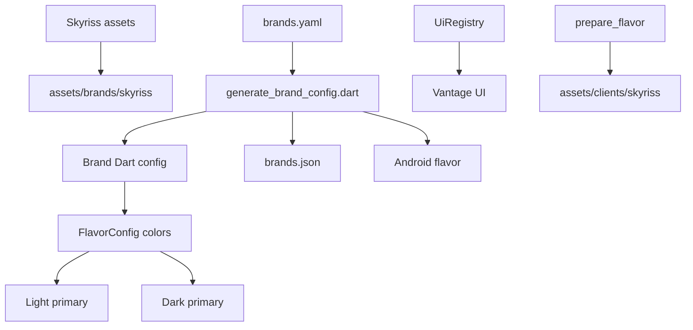

# Add Skyriss Child Flavor

## Goal
Add a new white-label child flavor named `skyriss` that inherits Vantage UI/screens, uses the supplied Skyriss artwork, and supports separate light/dark primary color values from `brands.yaml`.

## Approach
Use the existing single-source brand workflow: add Skyriss to `assets/config/brands/brands.yaml`, place source artwork under `assets/brands/skyriss/`, add a bundled app config folder, then regenerate derived config. Because the current generator and runtime only expose `primaryColor`, we will extend the generated/base flavor model to include `darkPrimaryColor` with a fallback to `primary`, then update light/dark theme usage so dark mode can use `darkPrimaryColor` without breaking existing brands.

## Steps
- [x] Step 1 — Create the source brand asset folder `assets/brands/skyriss/` and add the selected artwork:
  - `assets/brands/skyriss/icon.png` copied from `/Users/admin/Downloads/skyriss_logo_transperent.png`
  - `assets/brands/skyriss/logo.svg` copied from `/Users/admin/Downloads/skyriss_logo_transperent.svg`
  - `assets/brands/skyriss/splash_logo.svg` copied from `/Users/admin/Downloads/skyriss_logo_transperent.svg`
- [x] Step 2 — Create `assets/config/skyriss/app_config.json` by copying `assets/config/vantage/app_config.json` as the starting bundled app config, so `scripts/prepare_flavor.dart` can safely include `assets/config/skyriss/app_config.json` in `pubspec.yaml`.
- [x] Step 3 — Add a Skyriss child entry to `assets/config/brands/brands.yaml` under `brands:`:
  - `name: skyriss`
  - `type: child`
  - `inheritsFrom: vantage`
  - `label: Skyriss`
  - `themeMode: both` unless the product should be dark-only or light-only
  - Android package/app name and iOS bundle/app name for Skyriss
  - `colors.primary: "#0BFF00"`, `colors.darkPrimary: "#0BFF00"`, `colors.secondary: "#F8F3FF"`, `colors.accent: "#E77930"`
  - asset paths pointing to `assets/brands/skyriss/icon.png`, `logo.svg`, and `splash_logo.svg`
  - URLs initially copied from Vantage unless Skyriss has its own API/websocket/chart endpoints.
- [x] Step 4 — Update `scripts/generate_brand_config.dart` to parse and generate `darkPrimary`:
  - In `generateBrandConfigs`, read `final darkPrimary = colors['darkPrimary'] ?? primary;`.
  - Emit `darkPrimaryColor: const Color(0xFF...)` in generated `lib/clients/<brand>/config.dart`.
  - In generated `FlavorConfig`, add `final Color darkPrimaryColor`, constructor parameter, `_internal` field, `applyBranding` handling, and `toFlavorConfig` mapping.
  - Keep fallback behavior so existing brands without `darkPrimary` continue to use `primary`.
- [x] Step 5 — Update `lib/clients/base_config.dart` to include `final Color darkPrimaryColor` and accept an optional constructor parameter like `Color? darkPrimaryColor`, defaulting internally to `primaryColor`.
- [x] Step 6 — Update theme/color runtime usage:
  - In `lib/constants/color.dart`, change `AppColors.primary` dark-mode branch from hardcoded white to `FlavorConfig.instance.darkPrimaryColor` so brand dark primary is honored.
  - In `lib/main.dart`, update `_buildDarkTheme()` to use `FlavorConfig.instance.darkPrimaryColor` for `primaryColor`, `ColorScheme.dark(primary:)`, focused borders, elevated button background, and selected bottom navigation color.
  - Leave `_buildLightTheme()` using `FlavorConfig.instance.primaryColor`.
- [x] Step 7 — Update Vantage UI inheritance mapping:
  - In `lib/app/ui_registry.dart`, add `'skyriss': 'vantage'` to `_uiParentByClient`.
  - In `scripts/generate_brand_config.dart`, replace the generated `usesVantageUi()` hardcoded set `{'vantage', 'celestial', 'pipze'}` with a set derived from `brands.yaml` where the brand is `vantage` or `inheritsFrom: vantage`, so generated `lib/flavor_config.dart` also treats `skyriss` as Vantage UI.
- [x] Step 8 — Run the generator from the project root after code changes:
  - `dart run scripts/generate_brand_config.dart`
  - Verify it updates/creates `assets/config/brands/brands.json`, `lib/clients/skyriss/config.dart`, `lib/clients/skyriss/launcher_icons.yaml`, `lib/flavor_config.dart`, `android/brand_flavors.gradle`, `android/app/src/skyriss/`, and `.vscode/launch.json`.
- [x] Step 9 — Prepare/build Skyriss to validate assets and generated native resources:
  - `dart run scripts/prepare_flavor.dart skyriss`
  - Then build with `./build.sh skyriss apk release` or `./build.sh skyriss apk debug`.
  - Confirm `assets/clients/skyriss/` contains the copied PNG/SVG files and `android/app/src/skyriss/res/values/colors.xml` uses `#0BFF00` for splash/icon background.
- [x] Step 10 — Review generated files and lint/runtime behavior:
  - Confirm Skyriss appears in `Flavor` enum and launch configs.
  - Confirm Skyriss opens Vantage auth screens via `UiRegistry`.
  - Confirm light and dark theme primary colors both resolve to `#0BFF00`, secondary to `#F8F3FF`, and accent to `#E77930`.

## Files
- `assets/brands/skyriss/icon.png` — New Skyriss launcher icon source from the provided PNG.
- `assets/brands/skyriss/logo.svg` — New in-app logo source from the provided SVG.
- `assets/brands/skyriss/splash_logo.svg` — New splash logo source from the provided SVG.
- `assets/config/skyriss/app_config.json` — New bundled app config copied from Vantage as a safe default.
- `assets/config/brands/brands.yaml` — Add the Skyriss child brand entry and `darkPrimary` color.
- `scripts/generate_brand_config.dart` — Add `darkPrimary` generation and generated Vantage UI inheritance set.
- `lib/clients/base_config.dart` — Add `darkPrimaryColor` to shared brand config.
- `lib/constants/color.dart` — Use generated dark primary color in dark mode.
- `lib/main.dart` — Use `darkPrimaryColor` in `_buildDarkTheme()`.
- `lib/app/ui_registry.dart` — Map `skyriss` to Vantage UI.
- `assets/config/brands/brands.json` — Generated registry updated by the generator.
- `lib/clients/skyriss/config.dart` — Generated Skyriss Dart config.
- `lib/clients/skyriss/launcher_icons.yaml` — Generated Skyriss launcher icon config.
- `lib/flavor_config.dart` — Generated flavor enum/config with Skyriss and dark primary support.
- `android/brand_flavors.gradle` — Generated Android brand flavor list.
- `android/app/src/skyriss/` — Generated Android flavor manifest/resources.
- `.vscode/launch.json` — Generated debug/profile/release launch configs for Skyriss.

## Risks / Open questions
- The exact Android `applicationId` and iOS `bundleId` were not provided; use a placeholder pattern such as `com.skyriss.app` only if acceptable, otherwise confirm the final IDs before release.
- Skyriss API/websocket/chart URLs were not provided; copying Vantage URLs is only a default and should be replaced if Skyriss has separate backend endpoints.
- The provided SVG embeds a base64 PNG; it should render, but if size/performance is a concern, optimize it later.
- `AppColors.primary` currently returns white in dark mode for contrast; changing it to a brand dark primary may affect text/icon contrast on dark screens and needs visual QA.
