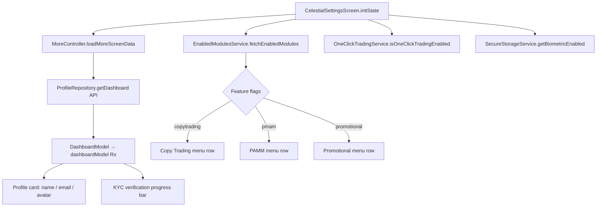

# Celestial Settings Screen — Full More/Settings Parity with Vantage/Pipze

## Goal
Replace the current minimal `CelestialSettingsScreen` with a full-featured screen that mirrors the layout, sections, logic, and API integrations of the existing `MoreScreen` (used by vantage/pipze), adapted to the Celestial brand's `CelTheme` design system.

## Approach
- Rewrite `lib/brands/celestial/celestial_settings_screen.dart` in-place — no new files needed.
- Keep `CelestialMainShell` unchanged (Settings tab already points to `CelestialSettingsScreen`).
- Use `MoreController` + `ProfileRepository` (already registered app-wide) for the dashboard/profile API.
- Use `EnabledModulesService` (already registered) for feature-flag-driven sections (copy-trading, PAMM, promotional).
- Style everything with `CelTheme.*` instead of `AppColors.*` so it fits the Celestial dark/light theme.
- The screen is **stateful** (biometric + one-click toggles require `setState`).
- All routes already exist in `Routes` / `AppPages` — no route additions required.

## Data / API flow

## Steps

- [x] **Step 1 — Rewrite `CelestialSettingsScreen`** (`lib/brands/celestial/celestial_settings_screen.dart`)
  - Convert class to `StatefulWidget` with `WidgetsBindingObserver` (same as `MoreScreen`).
  - In `initState`: call `Get.put(MoreController())`, `loadMoreScreenData()`, `EnabledModulesService.fetchEnabledModules(force: true)`, `_loadToggles()`.
  - Add `_oneClickEnabled` + `_biometricEnabled` state booleans.
  - Copy `_loadToggles`, `_toggleOneClickTrading`, `_toggleBiometric` from `MoreScreen` verbatim.
  - Copy `_handleSwitchToIB` from `MoreScreen` verbatim.
  - Copy `_calculateCompletion` helper verbatim.

- [x] **Step 2 — Profile card section**
  - `Obx(() => _buildProfileCard())` using `MoreController.dashboardModel`.
  - Avatar circle with first-letter initial using `CelTheme.buy(c)` gradient colours.
  - Edit button → `Get.toNamed(Routes.EDIT_PROFILE, arguments: isProfileVerified)`.

- [x] **Step 3 — KYC verification progress card**
  - `GetBuilder<MoreController>` that reads `dashboardModel.value?.data?.stageCompletion`.
  - Show `LinearProgressIndicator` with `CelTheme.buy(c)` colour.
  - Hide card when `completion == 100`.
  - Tap → `Get.toNamed(Routes.KYC_INTRO, arguments: stage)` then `loadMoreScreenData()`.

- [x] **Step 4 — Financial quick-action grid (2×2)**
  - Deposit → `Get.to(() => PaymentMethodsScreen(accountNumber: ''))`.
  - Withdraw → `Get.toNamed(Routes.WITHDRAWAL)`.
  - Transfer → `Get.toNamed(Routes.INTERNAL_TRANSFER)`.
  - History → `Get.toNamed(Routes.TRANSACTION_HISTORY)`.
  - Cards styled with `CelTheme.card(c)` background + coloured icon containers.

- [x] **Step 5 — "Trading Settings" section (menu list)**
  - Finance → `Get.toNamed(AppPages.FINANCE)`.
  - Promotional (conditional on `EnabledModulesService.isPromotionalMenuVisible`) → `PromotionalScreen`.
  - IB Dashboard → `_handleSwitchToIB()`.
  - Copy Trading (conditional on `modules?.copytrading`) → `Get.toNamed(Routes.COPY_TRADING_MAIN)`.
  - PAMM (conditional on `modules?.pmam`) → `Get.toNamed(Routes.PMAM_MAIN)`.

- [x] **Step 6 — "Security & Preferences" section (menu list)**
  - Theme toggle → `showThemeBottomSheet(context)` (only if `ThemeService.canUserChangeTheme`).
  - Change Password → `Get.toNamed(AppPages.CHANGE_PASSWORD)`.
  - Two-Factor Auth → `Get.toNamed(Routes.TWO_FACTOR_AUTH)`.
  - One-Click Trading toggle (animated custom switch) → `_toggleOneClickTrading()`.
  - Biometric Login toggle → `_toggleBiometric()`.

- [x] **Step 7 — "Account" section (menu list)**
  - Support Tickets → `Get.toNamed(Routes.TICKET_LIST)`.
  - Delete Account → `_showDeleteAccountDialog(authController)` (copy from `MoreScreen`).
  - Logout → `_showLogoutDialog(authController)` (copy from `MoreScreen`).

- [x] **Step 8 — App version footer**
  - `FutureBuilder<PackageInfo>` displaying `version_label + version`.

- [x] **Step 9 — Style all components with `CelTheme`**
  - Replace every `AppColors.cardBackground` → `CelTheme.card(c)`.
  - Replace `AppColors.primary` → `CelTheme.buy(c)`.
  - Replace `AppColors.textPrimary` → `CelTheme.mainText(c)`.
  - Replace `AppColors.textGrey` → `CelTheme.subText(c)`.
  - Replace `AppColors.border` → `CelTheme.divider(c)`.
  - Replace `AppColors.red` → `CelTheme.sell(c)`.
  - Keep icon accent colours (`Color(0xFF4CAF50)`, `0xFFFF9800`, etc.) as literal hex — they are brand-agnostic.

- [x] **Step 10 — Dialog helpers**
  - Copy `_showLogoutDialog` + `_showDeleteAccountDialog` + `_buildCompactDialogButton` from `MoreScreen`, swapping `AppColors` for `CelTheme`.

- [x] **Step 11 — Private model classes**
  - Copy `_CompactGridItem` + `_CompactMenuItem` data classes from `MoreScreen` to the bottom of the file (renamed `_CelGridItem` / `_CelMenuItem`).

- [x] **Step 12 — Verify imports compile**
  - `package:crm_app/screens/more/view_models/more_controller.dart` → `MoreController` + `StageCompletion`.
  - `package:crm_app/screens/finance/presentation/pages/payment_methods_screen.dart` → Deposit grid tap.
  - `package:crm_app/services/enabled_modules_service.dart`.
  - `package:crm_app/services/one_click_trading_service.dart`.
  - `package:crm_app/services/biometric_service.dart`.
  - `package:crm_app/services/app_lock_service.dart`.
  - `package:crm_app/services/secure_storage_service.dart`.
  - `package:crm_app/widgets/theme_bottom_sheet.dart`.
  - `package:crm_app/widgets/brand_logo.dart`.
  - `package:crm_app/screens/home/more/promotional/promotional_screen.dart`.
  - `package:crm_app/screens/home/more/one_click_trading_disclaimer_screen.dart`.
  - `package:crm_app/screens/ib/view_models/ib_controller.dart`.
  - `package:crm_app/widgets/custom_toast.dart`.
  - `package:package_info_plus/package_info_plus.dart`.
  - `package:flutter_svg/svg.dart`.
  - `package:crm_app/routes/app_pages.dart` for both `AppPages` and `Routes` (part-of relationship).
  - Zero lint errors confirmed.

## Files

| File | Action |
|------|--------|
| `lib/brands/celestial/celestial_settings_screen.dart` | **Full rewrite** — replace minimal screen with the full vantage-parity layout |

No other files need to change. Routes, bindings, and the main shell all remain untouched.

## Risks / Open questions

- **`MoreController` re-registration**: `MoreScreen` does `Get.put(MoreController())`. If `MoreScreen` is navigated to from elsewhere in the same session, there may be a duplicate registration. Use `Get.put(MoreController(), permanent: false)` or `Get.find<MoreController>()` with a fallback `Get.put` to avoid conflict.
- **`showThemeBottomSheet`**: Verify the function signature lives in `package:crm_app/widgets/theme_bottom_sheet.dart` (confirm before implementing Step 6).
- **`AppPages.FINANCE` vs `Routes.FINANCE`**: `AppPages` and `Routes` are separate constants; `FINANCE` only exists in `_Paths` (not in `Routes`). Use `'/finance'` literal or add `static const FINANCE = _Paths.FINANCE` to `Routes` in `app_routes.dart` if desired.
- **`AppPages.CHANGE_PASSWORD`**: Same situation — confirm it is accessible via `AppPages.CHANGE_PASSWORD` or use `Routes` equivalent.
- **`languageService.tr(...)` keys**: The Celestial brand already has `assets/translations/en.json` — verify the keys used by `MoreScreen` (e.g. `general_financial`, `general_deposit`, `general_withdraw`, `version_label`, `logout_confirm_message`) exist. If missing, use hard-coded English strings as fallback.
- **`_buildCompactVerificationCard` `GetBuilder<MoreController>`**: Requires `MoreController` to have been `Get.put`-ted before `build`. Ensure `initState` does this before the first frame.
