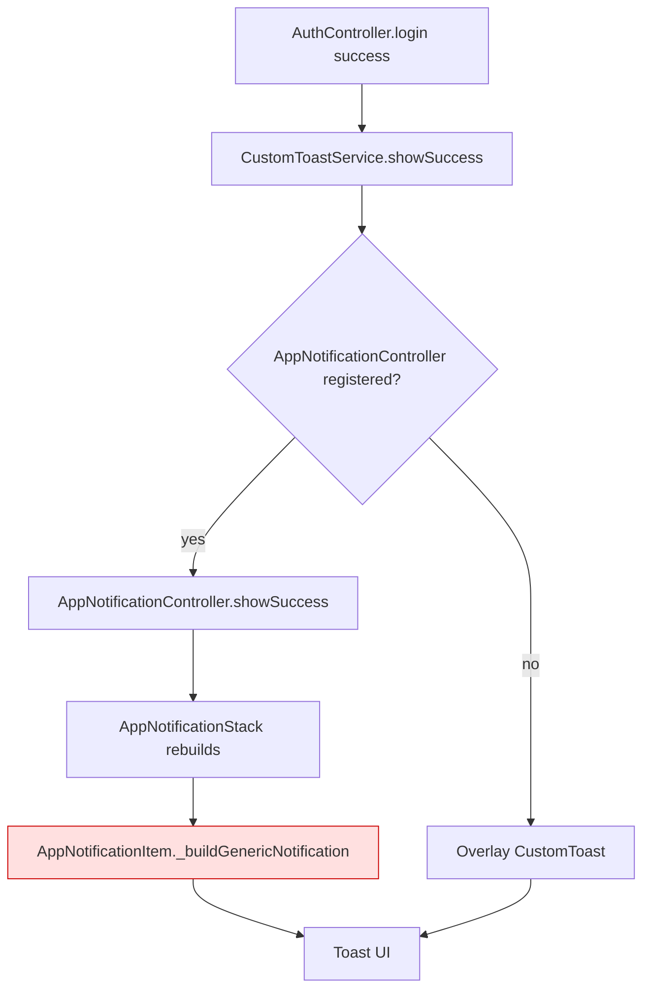

# Fix login toast UI mismatch between debug and release (white_label)

## Goal
The custom toast (e.g. "Login successful", "Please check…") renders correctly in CRM app but on white_label its UI changes between debug and release builds. We want the toast to look identical on debug, profile, and release — matching the CRM app's appearance and behavior.

## Background / Root cause analysis

After comparing both apps the difference is **not** in `CustomToastService.show` (it already uses a custom `OverlayEntry` precisely to avoid GetX snackbar inconsistencies — see comment in `lib/widgets/custom_toast.dart` lines ~165–172). The actual generic toast at login does NOT go through `CustomToast` at all — it is rendered by `AppNotificationStack` → `AppNotificationItem` because `AppNotificationController` is registered at startup, see `CustomToastService.showSuccess/showError` in `lib/widgets/custom_toast.dart` (the early-return `if (Get.isRegistered<AppNotificationController>())`).

`AppNotificationItem._buildGenericNotification` differs significantly between the two apps:

- crmapp `lib/widgets/app_notification_item.dart`
  - simple `Container` with full row width (`Row` + `MainAxisSize.min` but inside a `Positioned` from `AppNotificationStack` so width is bounded by `left:16, right:16`).
  - Uses `AppColors.primary` (static constant).
  - No `Align` / `ConstrainedBox(maxWidth)` / `IntrinsicWidth` wrapper.

- white_label `lib/widgets/app_notification_item.dart`
  - Wraps the toast in `Align(topCenter) → ConstrainedBox(maxWidth: 0.88.sw) → IntrinsicWidth → Container`.
  - Uses `FlavorConfig.instance.primaryColor` (runtime branding-aware) — value can change after `FlavorConfig.applyBranding(...)` during startup.
  - Adds a `boxShadow`.
  - Horizontal padding is `14.w` vs `16.w` in crmapp.

Why does it look different in release vs debug?
1. `IntrinsicWidth` re-measures children. In release the Flutter engine renders text with slightly different metrics from debug (font fallback, locale-bound shaping), and `IntrinsicWidth` then collapses the toast to a different visual width than in debug. Removing `IntrinsicWidth` + `Align` (CRM-style full-width container) eliminates this.
2. `FlavorConfig.instance.primaryColor` is evaluated at build time of the toast. In release the branding bootstrap (`FlavorConfig.applyBranding(...)` triggered by remote config / `AppConfigService`) can finish *before or after* the login toast is shown depending on timing, producing a different background color than in debug builds. Using a stable `AppColors.primary` (as crmapp does) avoids this.
3. `AppNotificationStack` lives inside `GetMaterialApp.builder` Stack — same in both apps — so the mount point is OK; the difference is purely the item widget.

Conclusion: make `AppNotificationItem._buildGenericNotification` match the crmapp implementation. Optionally also align the trading variant to keep behavior consistent.

## Approach
Port the simpler crmapp layout for `AppNotificationItem` into white_label so the visual is identical to crmapp and stable across debug/release. Key changes:

- Remove the `Align → ConstrainedBox → IntrinsicWidth` wrapper from the generic notification; use a plain full-width `Container` like crmapp.
- Replace `FlavorConfig.instance.primaryColor` with the stable `AppColors.primary` for the toast background, matching crmapp (this is what the toast is "supposed to" use — branded primary, not the dynamically re-assigned one).
- Drop the extra `boxShadow` (crmapp version has none) so the look is identical.
- Use `16.w` horizontal padding (matches crmapp).
- For the trading variant, also switch from `FlavorConfig.instance.primaryColor` to `AppColors.primary` so the on-chart trade toast is stable too.
- Do NOT touch `CustomToastService` or `AppNotificationStack` — they are already structurally identical to crmapp.

The red node is the file to fix.

## Steps
- [x] Step 1 — Open `lib/widgets/app_notification_item.dart` (white_label) and `../crmapp/lib/widgets/app_notification_item.dart` side by side as reference.
- [x] Step 2 — In `_buildGenericNotification`, remove the `Align` + `ConstrainedBox(maxWidth: CustomToast.maxWidthFactor.sw)` + `IntrinsicWidth` wrappers. The returned widget should be the plain `Container` (margin → decoration → padding → Row), exactly like crmapp.
- [x] Step 3 — Replace `final Color brandColor = FlavorConfig.instance.primaryColor;` (and its use as the `Container.color`) with `AppColors.primary`. Remove the now-unused `FlavorConfig` import if nothing else references it.
- [x] Step 4 — Remove the `boxShadow` from the generic notification's `BoxDecoration` (crmapp has none).
- [x] Step 5 — Change horizontal padding of the generic notification from `14.w` to `16.w` to match crmapp.
- [x] Step 6 — Replace remaining hard-coded `const Color(0xFFFFFFFF)` text color with `AppColors.whiteColor` for consistency with crmapp.
- [x] Step 7 — Use `AppColors` for the left-border colors in the switch (`AppColors.success`, `AppColors.error`, `AppColors.blue` for info, `AppColors.warning`, `AppColors.primary` for loading) — same as crmapp. Verified all constants (`AppColors.blue`, `success`, `error`, `warning`, `primary`) exist in `lib/constants/color.dart`; no addition needed.
- [x] Step 8 — In `_buildTradingNotification` replace `final Color bgColor = FlavorConfig.instance.primaryColor;` with `AppColors.primary` and update the left-border colors to use `AppColors.success` / `AppColors.error` / `AppColors.primary` (same pattern as crmapp). Keep the `textColor` as `AppColors.whiteColor`.
- [x] Step 9 — Run `flutter analyze` on the changed file → `No issues found! (ran in 2.9s)`.
- [ ] Step 10 — Test on a real device (REQUIRES USER):
  - [ ] Debug run: trigger login success/error, ensure toast looks correct.
  - [ ] Release build (`./build.sh` or `flutter build apk --release --flavor pipze --dart-define=CLIENT=pipze --dart-define=FLAVOR=pipze`) and verify the toast is visually identical to debug and to the crmapp version.
- [x] Step 11 — Decision taken: matched crmapp exactly (use `AppColors.primary` + removed `IntrinsicWidth`/`Align`/`ConstrainedBox` + dropped `boxShadow`). This both fixes the debug-vs-release rendering difference (IntrinsicWidth measurement) AND eliminates the dynamic `FlavorConfig.instance.primaryColor` timing/branding instability. If product later wants the dynamic broker-branded color, see Open questions — the wrapper removal alone would still resolve the size flicker.

## Files
- `lib/widgets/app_notification_item.dart` — main fix: align generic + trading notification UI with crmapp (remove IntrinsicWidth/Align/ConstrainedBox wrapper, use `AppColors.primary`, drop shadow, sync paddings/colors).
- `lib/constants/color.dart` — only if `AppColors.blue` (info left-border) is missing; add it.
- `lib/widgets/custom_toast.dart` — NO changes expected (it already mirrors crmapp). Only revisit if the overlay-fallback path also shows wrong UI — in that case copy the crmapp version of `_ToastShell` (remove IntrinsicWidth there too).

## Risks / Open questions
- Is the toast supposed to be **branded** (use `FlavorConfig.instance.primaryColor`, changes per flavor / per broker) or **fixed** like crmapp (`AppColors.primary`)? If branded is required, keep the color dynamic but still remove `IntrinsicWidth` — that alone removes the debug/release visual difference.
- `FlavorConfig.instance.primaryColor` is mutable via `applyBranding(...)`. If we keep using it, ensure the `AppNotificationStack` rebuilds when branding changes (currently it does not listen — the toast would render with whatever the value is at toast-mount time). The crmapp approach (static `AppColors.primary`) avoids this entirely.
- `boxShadow` was probably added intentionally for visual depth on white_label. Removing it makes the toast visually flat like crmapp. If design wants the shadow kept, leave it — it does not cause the debug/release issue.
- Confirm `AppColors.blue` / `AppColors.warning` / `AppColors.success` / `AppColors.error` exist in white_label's `lib/constants/color.dart` (they should, since CRM uses them). If not, the plan needs a small addition to that file.
- After the fix, perform release-build smoke test on at least one Android + one iOS device — release-only rendering issues sometimes only reproduce on physical devices.
