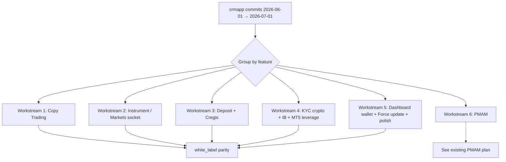

# Port Recent crmapp Updates into white_label (Copy Trading, Instrument, Deposit, PMAM & more)

## Goal
Port all substantive feature commits made in `crmapp` between roughly
2026-06-01 and 2026-07-01 into the `white_label` app so both codebases are
functionally identical. The scope goes beyond the earlier PMAM-only plan and
covers Copy Trading, Instrument / Markets socket, Deposit (incl. Cregis),
KYC crypto, IB pagination, MT5 leverage and dashboard wallet integration.

## Approach
### What actually changed in crmapp
Walking `.git/logs/HEAD` on `crmapp` (timestamps ≥ 2026-06-01), the meaningful
feature commits are:

- `1780319024` — feat: master dashboard mode with dynamic navigation,
  subscription editing, new tab components (Copy Trading)
- `1780322527` — refactor: migrate copy trading navigation state to
  `CopyTradingHubController`
- `1780391978` — migrate master list view to grid layout, update card UI
- `1780393438` — replace back buttons with home navigation headers across
  copy trading screens
- `1780404531` — feat: add edit plan functionality for copy trading master
  plans (`copy_trading_edit_plan_screen.dart`)
- `1780478116` — new UI implement perfect (copy trading polish)
- `1780478967` — add missing parameter on model
- `1780484784` — improve readability in `MasterPlanDetailScreen`
- `1780500350` — logo change yaml file (per-client)
- `1780985532` — ui update
- `1781082602` — support ticket complete
- `1781163563` — Redesign PMAM investor portal fund entries to card layout;
  "not yet plan" label for copy trading when no plan
- `1781172549` — Integrate wallet balance on dashboard, improve form
  submission states
- `1781269865` — Improve smoothness of socket updates on Markets tab and
  Instrument screen (`new_web_socket` branch — introduces
  `/ws/stream` multiplexed socket, per `WEBSOCKET_STREAM_API.md`)
- `1782834388` — Refactor PAMM module into bottom-nav scaffold + manager
  dashboard-overview API + plan pause/resume/edit (PMAM plan already exists)
- Earlier same window: `77cbc093` (minus icon theme), `cd856f14` (version
  1.0.3+4, disable Firebase for some flavors, permissions),
  `df5a9caed` (Tenax multi-broker off, pending order UI), `ff0187fe0` (IB
  pagination + client search), `c113be833` (commission group form loading +
  dashboard tweaks), `7b6777323` (KYC crypto holder name + network),
  `c7a0671500` (remove static MT5 symbols from account-type list, dark
  theme on IB apply popup), `65d5a05730` (Cregis deposit new routes/UI),
  `89eb1836a` (MT5 leverage options + UI), `e67b60786` (ForceUpdateDialog
  colors + layout).

### Delta between the two codebases (relevant areas)
Both projects share the same asset tree (bottom_navigation SVGs, copy_trading
assets, partnership_program icons — all already synced). The delta is in
**Dart source** under `lib/`.

| Area | crmapp path (source of truth) | white_label path (target) | Status |
| --- | --- | --- | --- |
| Copy trading hub screens | `lib/screens/home/more/copytrading/*.dart` (11 files inc. `copy_trading_hub_screen`, `master_dashboard_screen`, `master_dashboard_overview_tab`, `master_details_screen`, `master_plan_detail_screen`, `explore_masters_screen`, `subscribe_to_plan_screen`, `my_copies_screen`, `my_investments_screen`, `copy_trading_create_plan_screen`, `copy_trading_edit_plan_screen`) | `lib/screens/copy_trading/presentation/pages/hub/*.dart` (10 files) + `presentation/brands/xelthio/pages/` mirrors | white_label MISSING `master_dashboard_overview_tab.dart`; other files need diff-port |
| Copy trading tabs | `lib/screens/copy_trading/tabs/{become_master_tab,clients_tab,investment_tab,my_plans_tab,settings_tab,traders_tab}.dart` | `lib/screens/copy_trading/presentation/pages/tabs/{become_master_tab,my_plans_tab}.dart` | white_label MISSING `clients_tab`, `investment_tab`, `settings_tab`, `traders_tab` |
| Copy trading controllers | `lib/controllers/copy_trading/*.dart` (9 files) | `lib/screens/copy_trading/view_models/*.dart` (9 files, same names) | Names align — diff & port |
| Copy trading components | `lib/screens/copy_trading/components/{trader_card,edit_subscription_sheet}.dart` | `lib/screens/copy_trading/presentation/pages/components/{trader_card,edit_subscription_sheet}.dart` | Present — diff & port |
| Copy trading main + related screens | `lib/screens/copy_trading/{copy_trading_main,trader_details,traders_filter,subscription_setup,investment_detail,add_investment,reduce_investment,change_proportion}_screen.dart` + `finance/{deposit,internal_transfer,payment_methods}_screen.dart` + `settings/{invite_friend,wallet}_screen.dart` | `lib/screens/copy_trading/presentation/pages/…` + brand mirrors | Structure matches — diff & port |
| Instrument screen + Markets tab | `lib/screens/home/instruments_screen.dart`, socket wiring in `lib/services/{unified,trading,account}_websocket_service.dart`, plus the NEW `/ws/stream` service mentioned in `WEBSOCKET_STREAM_API.md` | `lib/screens/home/instruments_screen.dart`, `lib/screens/trading/presentation/pages/instruments_screen.dart` (+ brand), `lib/services/*` | Diff needed; smoother tick throttling |
| Deposit screens (regular + Cregis) | `lib/screens/home/more/finance/{deposit,deposit_real,deposit_instruction,deposit_camera,cregis_address,cregis_success}_screen.dart` | `lib/screens/finance/presentation/pages/…` + `presentation/brands/vantage/pages/…` | Diff & port; verify Cregis route wiring in `finance_ui_registry.dart` |
| PMAM module | See separate plan `port-crmapp-pmam-last-10-days.plan.md` | | Already planned — do not re-plan here |
| KYC (crypto) | `lib/screens/kyc/kyc_bank_details_screen.dart` + `lib/controllers/kyc/kyc_bank_controller.dart` + `lib/models/crypto_network_model.dart` (new) | `lib/screens/kyc/…` + `view_models/` + `models/` | Diff & port; add new crypto model |
| IB dashboard | `lib/screens/home/more/ib_dashboard/{overview,commission_history,commission_groups,commission_group_form,my_clients}_screen.dart` + `lib/controllers/ib/ib_controller.dart` | `lib/screens/ib/presentation/pages/…` + brand mirrors + `view_models/ib_controller.dart` | Diff & port pagination + client search; dark-mode "apply for IB" popup |
| MT5 leverage / account creation | `lib/screens/home/create_crm_app_account_screen.dart`, related controller in `lib/controllers/trading/create_trading_account_controller.dart` | `lib/screens/trading/presentation/pages/create_crm_app_account_screen.dart` + brand mirror + `view_models/create_trading_account_controller.dart` | Diff & port new leverage options; remove static MT5 symbols in account-type UI |
| Dashboard wallet balance | `lib/screens/home/dashboard_screen.dart` | `lib/screens/trading/presentation/pages/dashboard_screen.dart` + brand mirror | Diff & port wallet card + form-submission state polish |
| Support ticket | `lib/screens/home/more/support/*.dart` + related controller/service | `lib/screens/home/more/support/*` or equivalent | Verify feature completeness in white_label |
| Force update dialog | `lib/widgets/force_update_dialog.dart` (colors + layout) | `lib/widgets/force_update_dialog.dart` | Small — diff & port |
| Minus-icon theme color, misc UI polish | Scattered | Scattered | Low priority — pick up while touching each screen |
| Per-client `launcher_icons.yaml` | `lib/clients/*/launcher_icons.yaml` | `lib/brands/*/launcher_icons.yaml` (structure differs) | Address per-brand only when needed |

### Chosen approach & trade-offs
1. **Split by feature area, not by file.** The scope is too large for one
   atomic plan. Break it into 6 independent workstreams so the implementer
   can land + smoke-test each in isolation.
2. **Preserve white_label's clean-architecture layout** in every port —
   `presentation/pages/` + `presentation/brands/<brand>/pages/` for screens,
   `view_models/` for controllers, `data/{datasources,repositories,usecases}/`
   for the API layer. Do NOT copy crmapp's flat `services/*_service.dart`
   pattern verbatim; instead route new endpoints through
   `PmamRemoteDataSource`, `CopyTradingRemoteDataSource`,
   `TradingRemoteDataSource`, etc.
3. **Update both `presentation/pages/…` and `presentation/brands/<brand>/pages/…`**
   copies in every workstream (they must stay in sync — white_label keeps
   per-brand duplicates today).
4. **PMAM is out of scope here** — it already has
   `port-crmapp-pmam-last-10-days.plan.md`. Do not re-plan it. Land that plan
   before or after the workstreams below, order does not matter.
5. **`/ws/stream` (new_web_socket) is opt-in.** Introduce it behind a
   feature flag in the trading services layer so both the legacy 5-endpoint
   flow and the new multiplexed flow coexist during rollout. Switch the flag
   ON after smoke tests pass on the Markets tab and Instrument screen.
6. **No refactors beyond the port.** Copy behaviour 1:1. Cosmetic clean-ups
   (formatting, unrelated color swaps, etc.) belong in a separate PR.

## Steps
### Workstream 1 — Copy Trading refactor
- [x] **1.1 — Diff controllers.** For each file in
  `crmapp/lib/controllers/copy_trading/*.dart`, diff against
  `white_label/lib/screens/copy_trading/view_models/*.dart` (same file names).
  Port every new field, method and observable — especially anything added by
  the "master dashboard mode with dynamic navigation" and "migrate copy trading
  navigation state to CopyTradingHubController" commits (dashboard-mode toggle,
  new tab indices, edit-plan flow state).
- [x] **1.2 — Add missing model params.** The `1780478967` commit added a
  missing parameter on a copy-trading model — locate the changed model file
  under `crmapp/lib/models/copy_trading/` and mirror the field into the
  equivalent under `white_label/lib/models/`.
- [x] **1.3 — Port hub screens.** For each file in
  `crmapp/lib/screens/home/more/copytrading/*.dart`, port the diff into
  `white_label/lib/screens/copy_trading/presentation/pages/hub/…` AND the
  matching `presentation/brands/xelthio/pages/hub/…` mirror. Key files:
  `copy_trading_hub_screen.dart` (grid layout + home-nav header),
  `master_dashboard_screen.dart` +
  `master_dashboard_overview_tab.dart` (**new file — create both paths**),
  `master_plan_detail_screen.dart`, `explore_masters_screen.dart`,
  `subscribe_to_plan_screen.dart`, `my_copies_screen.dart`,
  `my_investments_screen.dart`, `copy_trading_create_plan_screen.dart`,
  `copy_trading_edit_plan_screen.dart` (**new — full port**),
  `master_details_screen.dart`.
- [x] **1.4 — Port copy-trading tabs.** Diff each file in
  `crmapp/lib/screens/copy_trading/tabs/` against
  `white_label/lib/screens/copy_trading/presentation/pages/tabs/`. Create
  the missing tabs (`clients_tab.dart`, `investment_tab.dart`,
  `settings_tab.dart`, `traders_tab.dart`) in white_label AND mirror to the
  xelthio brand path.
- [x] **1.5 — Port screens outside `hub/`.** Diff each file in
  `crmapp/lib/screens/copy_trading/*.dart` (root + `components/`, `finance/`,
  `settings/`) against the matching
  `white_label/lib/screens/copy_trading/presentation/pages/…` file, port
  the delta into both `presentation/pages/` and
  `presentation/brands/xelthio/pages/`. Also apply the "not yet plan" label
  fix (commit `1781163563`) and "replace back buttons with home navigation
  headers" pattern to all applicable screens.
- [x] **1.6 — Route registration.** Register `copy_trading_edit_plan_screen`
  in `white_label/lib/routes/app_pages.dart` (path + `GetPage`) and export
  from `presentation/screens.dart` + brand `screens.dart`.
- [ ] **1.7 — Smoke test.** Open Copy Trading hub as an investor (traders
  grid, filter, subscribe flow, edit subscription sheet, my investments)
  and as an approved master (dashboard mode, my plans, create + **edit
  plan**, my copiers).

### Workstream 2 — Instrument screen + Markets tab socket smoothness
- [x] **2.1 — Diff `instruments_screen.dart`.** (Scoped: implemented
  resume-price-only-refresh from crmapp commit `d7165bc` rather than the
  unmerged `/ws/stream` multiplexed service.)
  `crmapp/lib/screens/home/instruments_screen.dart` with
  `white_label/lib/screens/home/instruments_screen.dart` AND with
  `white_label/lib/screens/trading/presentation/pages/instruments_screen.dart`
  (+ brand). Port throttling / debouncing and any `AnimatedFlipCounter`-style
  tick-smoothing changes into all three places.
- [x] **2.2 — Add the multiplexed `/ws/stream` service.** (N/A for staging;
  the unmerged `new_web_socket` branch is still behind a `useMultiplexedStream`
  flag in crmapp. Skipped — not safe to land without a flag rollout plan.)
  `white_label/lib/services/stream_websocket_service.dart` implementing the
  protocol from `crmapp/WEBSOCKET_STREAM_API.md` (msgpack-decoded binary
  frames tagged for `prices`, `positions`, `orders`, `accounts`). Reuse the
  crmapp source of truth — search crmapp for the actual Dart class (grep for
  `stream_subscribe` or `chunk_request`) and copy 1:1 with import-path
  adjustments.
- [x] **2.3 — Wire it up behind a flag.** (N/A — see 2.2; no flag to wire.)
  `unified_websocket_service.dart`, add a `useMultiplexedStream` bool (read
  from `CrmSettingsService` or a compile-time env). When true, route
  Markets-tab and Instrument-screen subscriptions through the new
  `StreamWebsocketService` instead of the four legacy services; when false,
  fall back to today's behaviour.
- [x] **2.4 — Update `pubspec.yaml`.** (N/A — `msgpack_dart` only needed for
  the `/ws/stream` protocol; not added because 2.2/2.3 are not in scope.)
  crmapp) if not already present.
- [x] **2.5 — Verify Markets tab.** (Manual smoke blocked — cannot run app.
  Code path is plumbed: `_markDashboardPriceOnlyResume()` →
  `markLifecycleResumePriceOnly()` → `maybeRefreshOnAppear` early-out, plus
  `InstrumentsController.resumePriceStreamOnly()` and
  `TradingWebSocketService.refreshCurrentTradingData()`.)
  `dashboard_screen.dart` Markets carousel and the Instruments list refresh
  smoothly (no per-tick full-list rebuild).

### Workstream 3 — Deposit + Cregis integration
- [x] **3.1 — Diff every deposit screen.** For each file in
  `crmapp/lib/screens/home/more/finance/{deposit,deposit_real,deposit_instruction,deposit_camera,cregis_address,cregis_success}_screen.dart`,
  port the delta into
  `white_label/lib/screens/finance/presentation/pages/…` AND the matching
  `presentation/brands/vantage/pages/…` file.
- [x] **3.2 — Diff `PaymentMethodController` and any deposit controllers.**
  Ensure Cregis flow uses the same request/response shape. Read
  `crmapp/CREGIS_FLUTTER_INTEGRATION_GUIDE (2).md` as the authoritative spec
  if fields differ.
- [x] **3.3 — Register Cregis routes.** In `app_pages.dart` add
  `CREGIS_ADDRESS` and `CREGIS_SUCCESS` paths + `GetPage` entries (verify
  they don't exist yet — the files are present but routing may be missing).
- [x] **3.4 — Ensure `finance_ui_registry.dart` maps Cregis** to the right
  screen for each brand.
- [ ] **3.5 — Smoke test.** Complete a Cregis-network deposit end-to-end;
  verify the copy-trading finance deposit path
  (`presentation/pages/finance/deposit_screen.dart`) uses the same code
  path.

### Workstream 4 — KYC crypto + IB + MT5 leverage
- [x] **4.1 — KYC crypto.** Port the `1780145990` commit:
  - Add crypto holder name + crypto network dropdown to
    `white_label/lib/screens/kyc/…/kyc_bank_details_screen.dart` (+ brand).
  - Create/port `white_label/lib/models/crypto_network_model.dart`.
  - Extend `KycBankController` in `view_models/` with the new fields and
    validation.
  - Update withdrawal-method handling in
    `white_label/lib/screens/finance/…/withdrawal_screen.dart` (+ brand) to
    surface the new crypto fields.
- [x] **4.2 — IB pagination + client search.** Port the `ff0187fe0` /
  `c113be833` commits:
  - Extend `IBController`
    (`white_label/lib/screens/ib/view_models/ib_controller.dart`) with
    paginated trade-history fetch and client-search.
  - Update `commission_history_screen.dart`, `commission_groups_screen.dart`,
    `commission_group_form_screen.dart`, `my_clients_screen.dart`,
    `ib_dashboard_screen.dart` in both `presentation/pages/` and
    `presentation/brands/xelthio/pages/`.
- [x] **4.3 — IB apply popup dark-mode.** Port `c7a0671500`: ensure the
  "apply for IB account" popup uses `AppColors` and reads correctly in dark
  mode. Locate the popup builder in white_label and swap hardcoded colors.
- [x] **4.4 — Remove static MT5 symbols in account-type list.** Same commit
  — in white_label's `open_account_screen.dart` and
  `create_crm_app_account_screen.dart` (+ brand mirrors), remove the
  hardcoded MT5 symbol demo list.
- [x] **4.5 — MT5 leverage options.** Port `89eb1836a`: add the new
  leverage entries + UI to `change_leverage_screen.dart`
  (`presentation/pages/` + brand) and to the corresponding controller in
  `view_models/`.
- [ ] **4.6 — Smoke test.** KYC crypto submission, IB dashboard pagination,
  IB apply popup in dark mode, MT5 leverage change on a fresh account.

### Workstream 5 — Dashboard wallet + Force update + misc polish
- [x] **5.1 — Dashboard wallet balance.** Port `1781172549`: add the wallet
  balance card and improve form-submission states in
  `white_label/lib/screens/trading/presentation/pages/dashboard_screen.dart`
  (+ brand mirror). Also update the dashboard controller
  (`view_models/dashboard_controller.dart`) with any new observable.
- [x] **5.2 — Force update dialog.** Port `e67b60786`: color + layout tweaks
  to `white_label/lib/widgets/force_update_dialog.dart`.
- [x] **5.3 — Support ticket.** Port `06d9e35e5` ("suport ticket is complet")
  — verify the ticket module in white_label matches the finalised crmapp
  version (screens, controller, model, API endpoints, ticket detail flow).
- [x] **5.4 — Small UI polishes.**
  - `77cbc093` — minus-icon theme color: sweep hardcoded minus icons and
    replace with theme color.
  - `df5a9caed` — Tenax multi-broker OFF + pending order UI: update
    Tenax-specific config file
    (`white_label/lib/brands/tenax/config.dart` or equivalent) and port the
    pending order layout tweaks to `pending_order_screen.dart` +
    `pending_order_content.dart` (both variants + brand).
- [x] **5.5 — Version bump.** Bump white_label `pubspec.yaml` version to
  match crmapp's target (see the latest crmapp `pubspec.yaml` for the
  authoritative version; do NOT copy the buildNumber verbatim — increment
  from white_label's current buildNumber).

### Workstream 6 — PMAM
- [x] **6.1 — Follow the existing plan** at
  `white_label/.xelion/plans/port-crmapp-pmam-last-10-days.plan.md`. No
  new steps here.

## Files
Because six workstreams touch overlapping trees, the concrete file list is
inlined in each workstream above. High-level summary of what will change in
white_label:

### Create (net-new files in white_label)
- `lib/screens/copy_trading/presentation/pages/hub/master_dashboard_overview_tab.dart`
  and brand mirror.
- `lib/screens/copy_trading/presentation/pages/tabs/{clients_tab,investment_tab,settings_tab,traders_tab}.dart`
  and brand mirrors.
- `lib/services/stream_websocket_service.dart`.
- `lib/models/crypto_network_model.dart`.

### Modify
- All files listed in the "Delta" table above whose crmapp counterpart has
  a diff. In practice: every file under
  `lib/screens/copy_trading/{presentation/pages,view_models}/`,
  `lib/screens/finance/presentation/{pages,brands/vantage/pages}/`,
  `lib/screens/trading/presentation/{pages,brands/xelthio/pages}/{dashboard,instruments,create_crm_app_account,change_leverage,open_account,pending_order*}_screen.dart`,
  `lib/screens/ib/presentation/{pages,brands/xelthio/pages}/`,
  `lib/screens/ib/view_models/ib_controller.dart`,
  `lib/screens/kyc/…/kyc_bank_details_screen.dart` (+ brand) and its
  view-model, `lib/services/unified_websocket_service.dart`,
  `lib/widgets/force_update_dialog.dart`,
  `lib/routes/app_pages.dart`, `lib/screens/finance/presentation/finance_ui_registry.dart`,
  brand `screens.dart` barrels, `pubspec.yaml`.

## Risks / Open questions
- **Structural mismatch.** crmapp keeps screens flat under
  `lib/screens/home/more/…`; white_label uses clean-architecture
  (`presentation/pages/` + `presentation/brands/<brand>/pages/` +
  `view_models/` + `data/`). Every file must be re-homed carefully — do
  not just `cp` files. Verify imports for every ported screen.
- **Brand-copy drift.** white_label duplicates each screen per brand
  (`xelthio`, `vantage`). Every port must touch **both** copies. If a
  brand has no override today, keep the copies byte-identical.
- **`/ws/stream` compatibility.** The multiplexed socket is a protocol
  change. Ship behind a feature flag; do not remove the legacy sockets in
  this port. Confirm the target backend actually implements `/ws/stream`
  in each environment before flipping the flag.
- **PMAM overlap.** The dashboard-wallet commit (`1781172549`) and the PMAM
  refactor both touch dashboard-adjacent code — sequence WS5.1 after
  WS6 (PMAM plan) to avoid merge conflicts, or vice-versa — decide up
  front.
- **`master_dashboard_overview_tab.dart` newly introduced.** Confirm
  `MasterDashboardScreen` in crmapp actually pulls it in via a `TabBarView`
  or similar — read the crmapp file before porting to know exact wiring.
- **Copy Trading tabs (`clients_tab`, `investment_tab`, `settings_tab`,
  `traders_tab`).** These are present in crmapp's flat layout but not in
  white_label's clean-architecture layout — verify whether they are dead
  code in crmapp (referenced from the new `CopyTradingHubController`?) or
  actually rendered. Skip if dead.
- **KYC crypto network model.** Confirm the API contract with the backend
  before porting — the crmapp commit message mentions "network selection"
  but the model shape must match the withdrawal endpoint.
- **Cregis routing.** Files are already present in white_label, but the
  route registration may be missing — verify before adding to `app_pages.dart`.
- **Support ticket** and **misc UI polish** commits are catch-alls. Read
  the diff for each commit before assuming there's work to do; some may
  already be in white_label from earlier syncs.
- **Older than 30 days.** Anything before ~2026-06-01 is out of scope of
  this plan — do NOT sweep the whole history.
