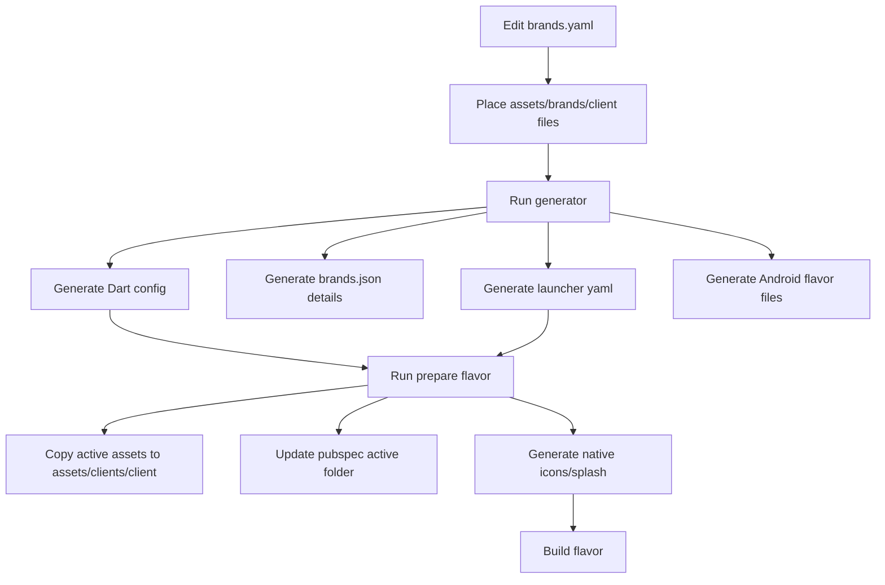

# Restructure Brand Assets and Flavor Setup

## Goal
Make the white-label brand/client setup easier to maintain by using one clear source of truth for each brand’s app icon, splash logo, logo SVG, colors, URLs, and parent-child UI inheritance. The goal is that adding or editing a client should mostly mean editing `assets/config/brands/brands.yaml` and placing files in one predictable asset folder.

## Approach
Use `assets/config/brands/brands.yaml` as the single human-edited brand manifest, and standardize brand artwork under `assets/brands/<brand>/` with required files like `icon.png`, `logo.svg`, and `splash_logo.svg`. Generated/runtime output should use `assets/clients/<brand>/` only as a build-prepared folder, instead of keeping duplicated source assets under both `assets/brands/...` and `lib/clients/.../assets/...`.

Current project findings:

- `assets/config/brands/brands.yaml` already describes parent-child brands and asset paths, but `scripts/generate_brand_config.dart` copies those assets into `lib/clients/<brand>/assets/`, creating duplicate source-of-truth folders.
- `scripts/prepare_flavor.dart` currently reads assets from `lib/clients/<flavor>/assets` and copies them to `assets/clients/<flavor>` before build.
- `pubspec.yaml` currently includes only the active prepared client folder, for example `assets/clients/pipze/`, which works with the build-preparation model.
- `lib/clients/base_config.dart` assumes asset paths are relative and builds runtime paths as `assets/clients/<client>/<file>`.
- `lib/flavor_config.dart` has hard-coded imports/getters for `tenax`, `vantage`, `celestial`, and `pipze`, so adding a brand still needs code changes unless this is generated or map-based.
- `lib/app/ui_registry.dart` hard-codes which child brands use Vantage UI with `_usesVantageUi`, even though `brands.yaml` already has `type` and `inheritsFrom`.
- `lib/brands/brand_resolver.dart` expects optional `brandDetails` in `brands.json`, but the current generator only writes `default` and `brands`, so parent-child metadata is not fully available at runtime.
- `assets/config/brands/brands.yaml` has a likely mistake for Pipze: `logo` and `splashLogo` point to `assets/brands/pipze/icon.png` instead of SVG files.
- Some launcher icon config paths are inconsistent: `lib/clients/tenax/launcher_icons.yaml` references `lib/clients/tenax/assets/app_icon.png`, while other brands reference `assets/brands/...` or `assets/clients/...`.

Recommended clean flow:

Key decisions / trade-offs:

- Keep `assets/brands/<brand>/` as the editable source folder because it already exists and matches `brands.yaml`.
- Keep `assets/clients/<brand>/` as generated/prepared build output because `BaseClientConfig.getAssetPath()` and `pubspec.yaml` already expect runtime assets there.
- Stop treating `lib/clients/<brand>/assets/` as source assets. `lib/clients/<brand>/` should contain generated Dart/YAML config only, not copied image/logo files.
- Improve scripts first instead of manually moving every reference in app screens, because the current app already relies on generated/prepared paths.
- Keep parent-child UI inheritance in `brands.yaml`, but make generated metadata and `UiRegistry` use it instead of hard-coded brand checks where practical.

## Steps
- [x] Step 1 — Define the final brand asset convention in `assets/config/brands/brands.yaml`: every brand should have `assets.appIcon`, `assets.logo`, and `assets.splashLogo` pointing to files under `assets/brands/<brand>/`; fix Pipze to use `assets/brands/pipze/logo.svg` and `assets/brands/pipze/splash_logo.svg` if those files are the intended logo/splash assets.
- [x] Step 2 — Normalize actual editable asset folders under `assets/brands/`: ensure each brand folder such as `assets/brands/vantage/`, `assets/brands/celestial/`, `assets/brands/pipze/`, and `assets/brands/tenax/` contains the required artwork names or update `brands.yaml` to match the real names.
- [x] Step 3 — Update `scripts/generate_brand_config.dart` so generated `lib/clients/<brand>/config.dart` still stores relative filenames for `BaseClientConfig`, but no longer copies brand artwork into `lib/clients/<brand>/assets/`.
- [x] Step 4 — Extend `scripts/generate_brand_config.dart` to generate `assets/config/brands/brands.json` with both the simple `brands` list and a `brandDetails` array containing `name`, `type`, `inheritsFrom`, `label`, colors, URLs, and asset paths, because `lib/brands/brand_resolver.dart` already tries to read `brandDetails`.
- [x] Step 5 — Update `scripts/generate_brand_config.dart` to generate consistent `lib/clients/<brand>/launcher_icons.yaml` files from `brands.yaml`, using the source icon path from `assets.appIcon` and the brand primary color as `adaptive_icon_background`.
- [x] Step 6 — Update `scripts/prepare_flavor.dart` so `copyClientAssets()` copies from `assets/brands/<flavor>/` to `assets/clients/<flavor>/` instead of from `lib/clients/<flavor>/assets/`.
- [x] Step 7 — Update `scripts/prepare_flavor.dart` so `generateLauncherIcons()` can use the generated `lib/clients/<flavor>/launcher_icons.yaml` consistently, and remove hard-coded/stale examples like `main_<flavor>.dart` from the success message.
- [x] Step 8 — Replace hard-coded flavor lists in `scripts/prepare_flavor.dart` and `build.sh` with values read from `assets/config/brands/brands.yaml` or generated `assets/config/brands/brands.json`, so adding a brand does not require editing multiple lists.
- [x] Step 9 — Improve `lib/flavor_config.dart` generation or lookup: either generate the enum/import/getter section from `brands.yaml`, or introduce a map-based resolver so new brands do not require manually adding imports and static getters.
- [x] Step 10 — Improve `lib/app/ui_registry.dart` so child UI inheritance is driven by generated brand metadata from `brands.yaml` where possible; at minimum, replace `_usesVantageUi` with a clearer helper that maps `celestial` and `pipze` to parent `vantage` based on `inheritsFrom`.
- [x] Step 11 — Keep `pubspec.yaml` using only `assets/clients/<activeFlavor>/` for the active build, but add a clear generated-marker comment around the active client asset line so `scripts/prepare_flavor.dart` can update it safely and readably.
- [x] Step 12 — Remove duplicated/generated asset copies from `lib/clients/<brand>/assets/` after scripts no longer depend on them, and keep `lib/clients/<brand>/` focused on generated config files.
- [x] Step 13 — Update developer documentation in `README.md` or create a new doc under `docs/` explaining the simple client workflow: add brand entry in `brands.yaml`, add three assets under `assets/brands/<brand>/`, run `dart run scripts/generate_brand_config.dart`, then run `./build.sh <brand> apk release`.
- [x] Step 14 — Validate by regenerating configs for existing brands, preparing/building one parent brand (`vantage`) and one child brand (`pipze` or `celestial`), and checking that logo/splash/icon paths resolve to `assets/clients/<brand>/...` at runtime.

## Files
- `assets/config/brands/brands.yaml` — Main editable brand manifest; fix asset paths and keep parent-child metadata here.
- `assets/brands/<brand>/` — Editable source artwork folders for app icon, logo SVG, and splash SVG.
- `scripts/generate_brand_config.dart` — Generate Dart configs, launcher icon YAML, Android flavor setup, VS Code launch configs, and richer `brands.json` from one YAML file.
- `scripts/prepare_flavor.dart` — Prepare active client assets from `assets/brands/<brand>/` into `assets/clients/<brand>/`, update `pubspec.yaml`, and generate splash/icon resources.
- `build.sh` — Use the generated brand list instead of stale hard-coded client names and update usage examples.
- `lib/clients/base_config.dart` — Keep runtime asset path convention as `assets/clients/<client>/<file>`; optionally improve comments to explain source vs prepared assets.
- `lib/clients/<brand>/config.dart` — Generated brand config files; should contain filenames and values from `brands.yaml` only.
- `lib/clients/<brand>/launcher_icons.yaml` — Generated launcher icon config files; should use consistent source icon paths.
- `assets/config/brands/brands.json` — Generated runtime registry; should include brand details for parent-child inheritance.
- `lib/flavor_config.dart` — Refactor or generate brand initialization so adding a brand is easier and less manual.
- `lib/app/ui_registry.dart` — Make parent-child UI inheritance clearer and less hard-coded.
- `pubspec.yaml` — Keep active `assets/clients/<brand>/` entry but make script-managed section clearer.
- `README.md` or `docs/BRAND_FLAVOR_WORKFLOW.md` — Document the new simple workflow.

## Risks / Open questions
- iOS flavor support appears less generated than Android; this plan focuses mainly on the current Android/build-script path unless iOS schemes/icons also need full automation.
- `assets/brands/tenax/` is not shown in the current tree while `lib/clients/tenax/assets/` exists; Tenax assets need to be copied or renamed into the new source convention before removing duplicates.
- `FlavorConfig` currently uses hard-coded imports and enum values, so making brand addition truly zero-code-change needs either code generation or a bigger runtime-config refactor.
- `UiRegistry` cannot fully load async `BrandResolver` data inside synchronous widget factory methods without design changes; parent-child UI inheritance may need a generated sync map.
- `prepare_flavor.dart` edits `pubspec.yaml`; this is convenient but risky if formatting changes. Use a clearly marked script-managed section to reduce accidental damage.
