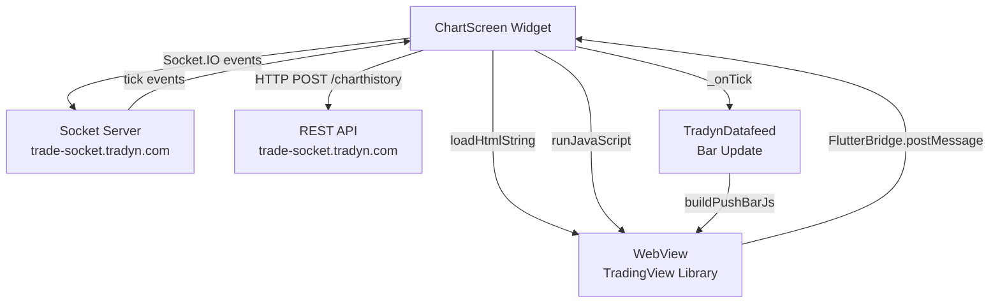
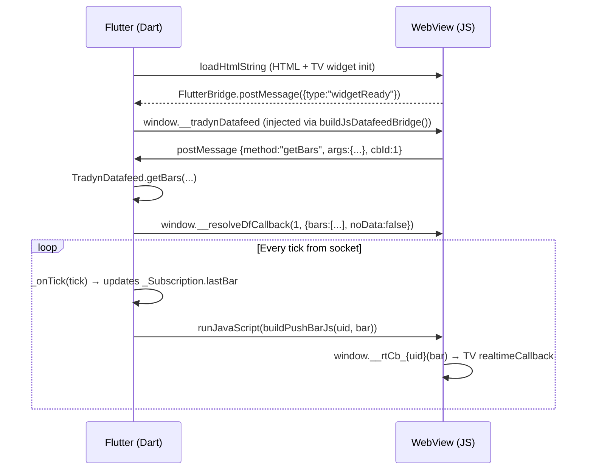
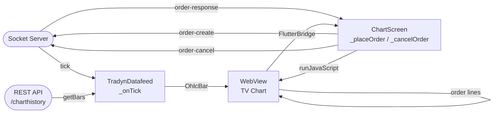

# TRADYN — Flutter ChartScreen Implementation Guide

## Files Produced

| File | Description |
|---|---|
| `flutter/chart_screen.dart` | Full `ChartScreen` StatefulWidget (Buy/Sell panel, bid-ask lines, position & order lines) |
| `flutter/datafeed.dart` | `TradynDatafeed` class — history fetch, tick streaming, JS bridge builder |

---

## Architecture Overview



---

## 1 — pubspec.yaml Dependencies

```yaml
# /pubspec.yaml
dependencies:
  flutter:
    sdk: flutter
  webview_flutter: ^4.7.0
  socket_io_client: ^2.0.3+1
  http: ^1.2.1
```

Run:
```shell
flutter pub get
```

---

## 2 — TradingView Library Assets

The TradingView `charting_library` folder must be in your Flutter assets:

```
assets/
  charting_library/
    charting_library.standalone.js
    charting_library/          ← sub-folder with bundles
```

Add to `pubspec.yaml`:

```yaml
# /pubspec.yaml
flutter:
  assets:
    - assets/charting_library/
```

> **Note:** You must license TradingView's charting library separately.  
> The WebView loads the library via `<script src="charting_library/charting_library.standalone.js">`.  
> For local asset loading in WebView use `loadFlutterAsset` or serve via localhost.

---

## 3 — Wiring ChartScreen in Your App

```dart
// /lib/main.dart  (example)
import 'package:flutter/material.dart';
import 'package:socket_io_client/socket_io_client.dart' as IO;
import 'chart_source/flutter/chart_screen.dart';

void main() => runApp(const TradynApp());

class TradynApp extends StatefulWidget {
  const TradynApp({super.key});
  @override
  State<TradynApp> createState() => _TradynAppState();
}

class _TradynAppState extends State<TradynApp> {
  late IO.Socket _socket;

  @override
  void initState() {
    super.initState();
    _socket = IO.io(
      'https://trade-socket.tradyn.com',
      IO.OptionBuilder()
          .setTransports(['websocket'])
          .enableAutoConnect()
          .build(),
    );
  }

  @override
  Widget build(BuildContext context) {
    return MaterialApp(
      home: Scaffold(
        body: ChartScreen(
          visible: true,
          symbol: const SymbolInfo(symbol: 'EURUSD', volumeMin: 0.01),
          socket: _socket,
          user: const UserInfo(login: 123456, trading: true),
          isDark: true,
          language: 'en',
          theme: const AppTheme(),
          clientId: 'your_client_id',
          server: 'your_server_name',
          onNotification: (n) => debugPrint('${n.title}: ${n.content}'),
          platform: 'android',
        ),
      ),
    );
  }
}
```

---

## 4 — How the JS Bridge Works



---

## 5 — Key Method Map (JS → Dart)

| React / JS | Flutter / Dart |
|---|---|
| `useState` | `setState()` in `StatefulWidget` |
| `useEffect` | `initState`, `didUpdateWidget`, `dispose` |
| `useRef` | class-level fields (`late`, `_field`) |
| `socket.on('tick', handler)` | `socket?.on('tick', (data) {...})` |
| `Haptics.vibrate()` | `HapticFeedback.vibrate()` |
| `Haptics.notification(Success)` | `HapticFeedback.mediumImpact()` |
| `widget.activeChart().createShape(...)` | `window.__updateBidAsk(...)` via `runJavaScript` |
| `chart.createPositionLine()` | `window.__renderPositionLines([...])` via `runJavaScript` |
| `chart.createOrderLine()` | `window.__renderOrderLines([...])` via `runJavaScript` |

---

## 6 — Passing Data to ChartScreen

### Symbol list (from server)
```dart
// Convert JSON list to SymbolInfo list
final List<SymbolInfo> symbolList = (jsonData['symbols'] as List)
    .map((e) => SymbolInfo.fromJson(e as Map<String, dynamic>))
    .toList();
```

### Positions & Orders format
```dart
// positions map structure
final positions = {
  'data': {
    '123': {'id': 123, 'symbol': 'EURUSD', 'action': 0,
             'volume': 0.1, 'open_price': 1.0850, 'profit': 12.5},
  },
  'posObj': {
    'EURUSD': ['123'],
  },
};

// orders map structure
final orders = {
  'data': {
    '456': {'order_id': 456, 'symbol': 'EURUSD', 'type': 2,
             'volume': 0.1, 'open_price': 1.0800},
  },
  'ordersObj': {
    'EURUSD': ['456'],
  },
};
```

---

## 7 — Serving TradingView Assets Locally

For WebView to load `charting_library` from Flutter assets, use a local HTTP server or the WebView's `loadFlutterAsset`:

```dart
// Option A — serve assets via flutter_inappwebview (alternative package)
// Option B — copy assets to cache dir and use file:// URI

import 'dart:io';
import 'package:path_provider/path_provider.dart';
import 'package:flutter/services.dart';

Future<String> getChartLibraryPath() async {
  final dir = await getApplicationSupportDirectory();
  final dest = Directory('${dir.path}/charting_library');
  if (!dest.existsSync()) {
    // Copy from assets on first run
    final manifest = await rootBundle.loadString('AssetManifest.json');
    // ... iterate and copy charting_library files
  }
  return 'file://${dir.path}';
}
```

---

## 8 — Android & iOS Permissions

### AndroidManifest.xml
```xml
<!-- /android/app/src/main/AndroidManifest.xml -->
<uses-permission android:name="android.permission.INTERNET"/>
<uses-permission android:name="android.permission.VIBRATE"/>
```

### Info.plist (iOS)
```xml
<!-- /ios/Runner/Info.plist -->
<key>NSAppTransportSecurity</key>
<dict>
  <key>NSAllowsArbitraryLoads</key>
  <true/>
</dict>
```

---

## 9 — Complete Data Flow



---

## 10 — Files Reference

```
TRADYN/source_code/chart_source/
├── ChartScreen.jsx        ← original React source
├── Datafeed.js            ← original JS datafeed
└── flutter/
    ├── chart_screen.dart  ← Flutter conversion of ChartScreen.jsx
    └── datafeed.dart      ← Flutter conversion of Datafeed.js
```
