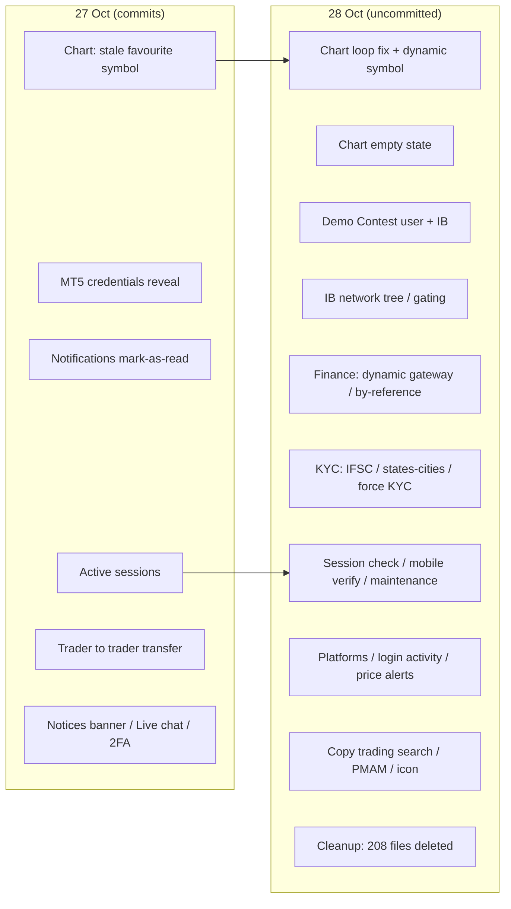
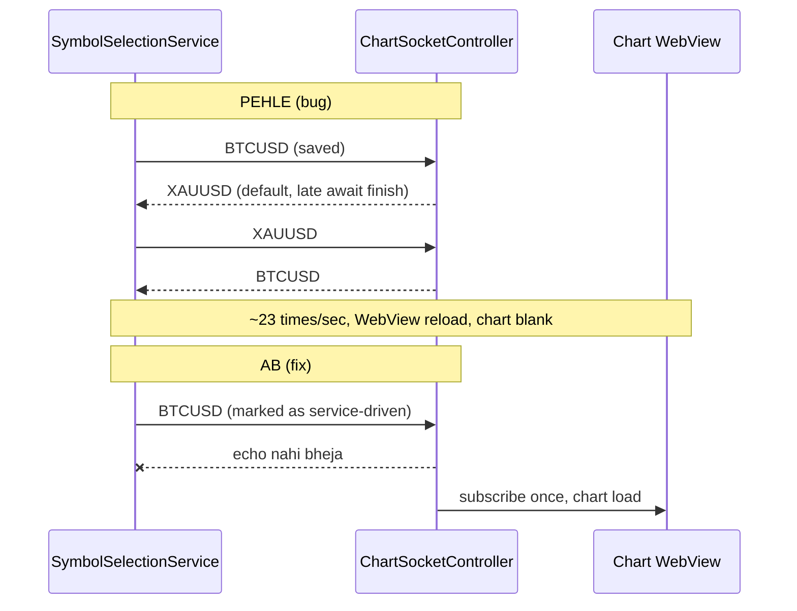
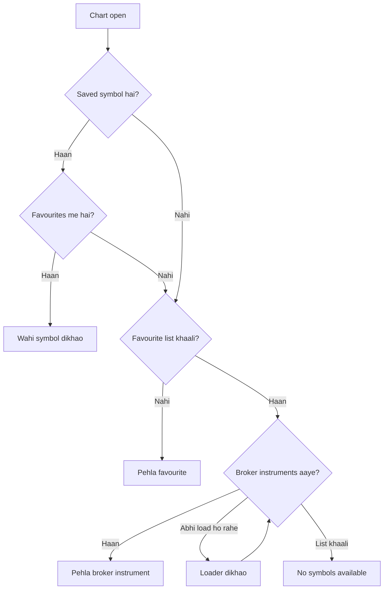
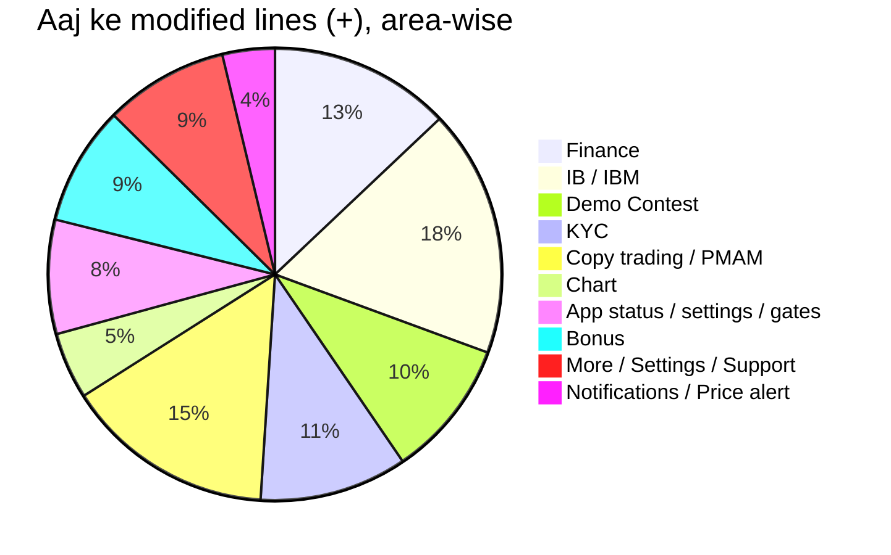
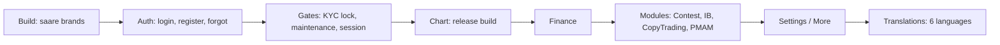

# Report: 27 aur 28 Oct 2026 ke changes + testing guide

Ye report git se banayi hai:
- `git log --since 2026-10-27`: 2 commits.
- `git status` aur `git diff HEAD`: abhi tak commit nahi hua kaam.

## 0. Ek nazar me

| Kya | Kab | Kitna |
|---|---|---|
| Commit `50f32d4` (Akash): chart symbol, favourite hatane wala fix | 27 Oct 12:50 | 2 Dart files, +57 |
| Commit `ab2f5e1` (Mohit): MT5 credentials, notifications, active sessions, trader transfer | 27 Oct 18:55 | 32 files, +2843 |
| Uncommitted: modified files | 28 Oct (aaj) | 122 files, +4122 / −1021 |
| Uncommitted: nayi files | 28 Oct | 23 files, ~6800 lines |
| Uncommitted: delete ki hui files (staged) | 28 Oct | 208 files |

**Aaj ke checks ka result**
- `flutter analyze` (pura project): **0 errors**. 365 warnings/info hain, sab purani.
- `flutter test`: **10/10 pass**.
- Riyadex **release build**: ban gaya aur device par install hua.
- Device par sirf **chart loop fix** verify hua hai. Baaki sab ka code likha hai aur analyze clean hai, par **manual test baaki** hai.

Status ke nishaan:
- ✅ device par verified
- 🟡 code likha + analyze clean, manual test baaki
- ⚠️ risk ya pending, dhyan se check karna

---

## 1. Kal: 27 Oct

### 1.1 Chart symbol jab favourites se hata diya jaye (`50f32d4`) 🟡
**Files:** `chart_screen.dart`, `symbol_selection_service.dart`

**Kya kiya:** app restart par pichhla saved symbol agar ab favourites me nahi hai, toh chart ek baar preferred symbol par switch ho jaata hai. Iske liye `isRestoredSelection` aur `_replaceStaleRestoredSymbol` add kiye.

**Test:**
- [ ] Symbol A chuno, use favourites se hatao, app kill karke kholo. Chart A nahi, favourite list ka symbol dikhaye.
- [ ] Symbol A favourites me hi rehne do aur restart karo. Chart A hi dikhaye.

### 1.2 MT5 credentials ek baar reveal karna (`ab2f5e1`) 🟡
**Files:** `notifications/.../widgets/mt5_credentials_sheet.dart`, `notification_model.dart`, `notification_controller.dart`

**Test:**
- [ ] Naya MT5 account banao. Notification aaye, tap karne par credentials sheet khule (login, password, server).
- [ ] Copy button kaam kare.
- [ ] Sheet band karke dobara kholo. Password dobara na dikhe (one-time).

### 1.3 Notifications: mark-as-read 🟡
**Files:** `notification_api_provider.dart`, `notifications_screen.dart`

**Test:**
- [ ] Ek notification tap karo. Wo read ho jaaye aur unread badge ghate.
- [ ] "Mark all read" dabao. Saare read ho jaayein aur badge 0 ho.
- [ ] Notification list scroll karo. Aaj ka change pagination ko naye `notifications/all` response par le gaya hai (section 2.9), isliye next page load hona chahiye.

### 1.4 Active Sessions 🟡
**Files:** `home/more/active_sessions_screen.dart`, `active_sessions_controller.dart`, `setting_screen.dart`

**Test:**
- [ ] Settings → Active Sessions. Saare logged-in devices ki list dikhe.
- [ ] Doosre device ka session revoke karo. Wo device logout ho jaaye (section 2.10 ka session check bhi dekho).
- [ ] Current device par "this device" ka label dikhe aur use revoke na kar sako.

### 1.5 Trader-to-trader transfer 🟡
**Files:** `finance/.../trader_transfer_screen.dart` (712 lines), `trader_transfer_controller.dart`, `finance_screen.dart`

**Test:**
- [ ] Finance → Transfer to trader. Receiver ka email ya ID daalo, receiver ki details aayein.
- [ ] Amount wallet balance se zyada daalo. Error aaye.
- [ ] Sahi amount daalo, OTP ya confirm karo. Success aaye aur dono taraf balance update ho.
- [ ] Galat receiver daalo. Backend ka message dikhe.

### 1.6 Kal ke baaki changes 🟡
- **Active notices banner** (`widgets/active_notices_banner.dart`, dashboard): admin notice ho toh dashboard par banner dikhe aur dismiss ho sake.
- **Live chat** (`live_chat_service.dart`, support screen): support me live chat khule.
- **Google OTP / 2FA** (`google_otp_service.dart`, `two_factor_auth_controller.dart`): 2FA on/off ho aur galat code reject ho.
- **Translations:** 6 language files me 62 nayi keys. Har language me naye screens par raw key (jaise `trader_transfer_title`) nahi dikhni chahiye.

---

## 2. Aaj: 28 Oct

### 2.1 Chart blank aur reload loop fix (Riyadex release) ✅
**Problem:** chart ka symbol do jagah sync hota tha: `SymbolSelectionService` aur `ChartSocketController`. Code ka default `XAUUSD` aur saved `BTCUSD` app start par ek saath switch hote the. Socket ka symbol ek `await` ke baad set hota hai, isliye jo switch late khatam hota, wo doosre ko purane symbol par wapas daal deta. Isse loop ban jaata: ek second me ~23 baar symbol badalta, subscribe hota aur WebView reload hota. Chart blank dikhta tha.

**Fix:**
- `chart_socket_controller.dart`: jo symbol change service se aata hai, wo wapas service ko nahi bheja jaata. Purana switch late khatam ho toh latest symbol dobara lagta hai.
- `symbol_selection_service.dart`: naya `fallbackSymbol()`. Pehle user ka pehla favourite, phir broker list ka pehla instrument, warna `''`.
- `chart_screen.dart` aur `vantage_chart_layout.dart`: saare hardcoded `XAUUSD` hataye. Ab koi bhi symbol ho, sab ke liye same kaam karta hai.

**Device result:** pehle ~23 saves/sec aur lagatar reload. Ab cold start par 1 save aur 1 subscribe.

**Test:**
- [ ] Riyadex **release** build me cold start karke Chart tab kholo. Ek baar load ho, flicker na ho.
- [ ] Chart par 30 sec ruko. Header ka symbol na badle, candles live chalein.
- [ ] Picker se doosra favourite chuno. Chart, header aur BUY/SELL prices teeno badlein.
- [ ] Prices tab se koi symbol tap karo (AUDGBP, EURUSD). Chart wahi khole.
- [ ] A → B → C jaldi-jaldi badlo. Chart C par ruke.
- [ ] Naya user jiske favourites khaali hain: chart broker list ke pehle instrument par khule.
- [ ] Doosre brands (pippro, pipze, tenax, moneygenius) me chart normal chale.
- [ ] `adb logcat | grep "Selected symbol saved"` chalao. Line baar-baar repeat na ho.

### 2.2 Symbol na ho tab chart ka empty state 🟡
**File:** `vantage_chart_layout.dart`, `_buildNoSymbolState()`

**Test:**
- [ ] Slow network par fresh login karke Chart kholo. Pehle loader dikhe, phir chart.
- [ ] Jis account me broker koi instrument nahi bhejta, usme "No symbols available" dikhe.
- [ ] Khaali symbol par BUY/SELL dabao. Order na jaaye, warning aaye.
- [ ] ⚠️ Khaali symbol par pending order aur price alert screen abhi bhi khul sakti hain. Ye known gap hai.

### 2.3 Copy Trading: Investments icon 🟡
**Files:** `assets/svg/copy_trading/bottom_navigation/investments.svg` aur `investments_bold.svg`. Naya design: dollar coin ke saath upar jaata arrow.

**Test:**
- [ ] Copy Trading ke bottom bar me naya icon dikhe, aur selected/unselected dono haalat me saaf dikhe.
- [ ] Dark mode me bhi icon saaf dikhe.

### 2.4 Copy Trading: plan search aur PMAM 🟡
**Files:**
- `copy_trading_masters_controller.dart` (`copytrading/plans/search`, `planSuggestions`)
- `explore_masters_screen.dart`
- `pmam_controller.dart`, `pmam_service.dart`, `pmam_explore_managers_screen.dart`
- naya `pmam_manager_commissions_screen.dart`

**Test:**
- [ ] Explore masters me search box me 2-3 akshar likho. Suggestions aayein, ek chuno toh wahi plan filter ho.
- [ ] Search khaali karo. Poori list wapas aaye.
- [ ] PMAM Explore managers me search kaam kare.
- [ ] PMAM manager → Commissions. Settled rows dikhen aur scroll karne par next page load ho.
- [ ] PMAM create plan me eligible accounts ka dropdown bhar jaaye.

### 2.5 Demo Contest: user side (naye endpoints) 🟡
**Files:**
- `demo_contest_service.dart`, `demo_contest_controller.dart`
- models (`demo_contest_enrollment_model.dart`, `leaderboard_entry_model.dart`, `demo_contest_my_stats_model.dart`)
- widgets `enrollment_steps_card.dart` aur `contest_activity_card.dart`
- `utils/demo_contest_menu.dart`

**Test:**
- [ ] `enabled-modules.democontest` ON ho toh menu dikhe, OFF ho toh na dikhe.
- [ ] `demo_contest_menu_inside_promotion` ON ho toh menu Promotions ke andar `demo_contest_menu_label` naam se dikhe.
- [ ] Contest list load ho, aur "My enrollments" me sirf mere contests hon.
- [ ] Contest details par steps card dikhe. Step tap karne par link khule aur step "done" ho jaaye.
- [ ] Join karo. Terms accept karne ka flow aaye, enroll-preview me details dikhen, aur backend ka message toast me aaye.
- [ ] Leaderboard me meri row highlight ho (`is_me`).
- [ ] My Stats par trading history aur rule violations ki list dikhe.
- [ ] Claim button sirf tab dikhe jab contest khatam ho, main disqualified na hoon aur claim pehle na kiya ho.
- [ ] Claim karne ke baad status dikhe, aur claim object aane par app crash na ho.
- [ ] ⚠️ Naye widgets ki translation keys saari 6 language files me hain ya nahi, check nahi kiya.

### 2.6 Demo Contest: IB side 🟡
**Files:** naye `ib_demo_contests_screen.dart` (924 lines) aur `ib_demo_contest_controller.dart`; endpoints `ib/demo-contest/*`

**Test:**
- [ ] IB → My contests. Is IB ke banaye contests dikhen.
- [ ] Naya contest banao (instruments ka dropdown, dates, prize). Save hone ke baad list me aaye.
- [ ] Contest edit karo. Badlav save ho.
- [ ] Prize fund add karo. Amount badhe.
- [ ] Contest cancel karo. Status "cancelled" ho.
- [ ] Enrollments khol kar approve aur reject karo. Status badle.
- [ ] Dates `2026-11-01` format me dikhen.

### 2.7 IB: network tree, activities, gating 🟡
**Files:**
- `ib_network_tree_screen.dart` (naya), `ib_controller.dart`, `ib_dashboard_new_screen.dart`
- `commission_group_form_screen.dart` (template rates), IB repo/datasource
- `ibm_controller.dart` (`checkSystemAndNavigate` guard)
- `meta_settings_screen.dart`, `celestial_settings_screen.dart`, `iquote_assets_layout.dart`, `banner_controller.dart`

**Test:**
- [ ] IB → My Network. Tree dikhe, naam/email se search ho, aur node tap karne par us IB ki details aayein.
- [ ] IB dashboard par Recent activities dikhen.
- [ ] Commission group form me template chuno. Rates auto-fill hon.
- [ ] IB module OFF ho toh IB tiles na dikhen, aur kisi IB entry ko kholne par `ib_unavailable` toast aaye.
- [ ] IB module ON ho toh sab normal khule.
- [ ] ⚠️ `handleSwitchToIB` wale saare tiles gated hain ya nahi, poora check nahi hua.

### 2.8 Finance: deposit aur withdrawal 🟡
**Files:**
- naya `widgets/dynamic_gateway_deposit_form.dart`
- `deposit_instruction_controller.dart` (UniPayment aur dynamic deposit), `deposit_instruction_screen.dart`
- `cregis_success_screen.dart` (by-reference polling)
- `deposit_controller.dart`, `withdrawal_controller.dart`, `payment_methods_screen.dart`, `withdrawal_screen.dart`, `finance_screen.dart`

**Test:**
- [ ] **Dynamic gateway:** card gateway (`enet_*`) par card fields aayein, aur push-prompt gateway par payer mobile field aaye. Submit karne par reference number mile.
- [ ] **UniPayment:** submit karne par invoice URL khule.
- [ ] **By-reference polling:** payment karke wapas aao. Approved, success ya completed par success screen aaye. Rejected, failed ya cancelled par polling ruke aur fail message dikhe.
- [ ] **Wallet-only:** setting ON ho toh deposit aur withdrawal me sirf wallet option aaye.
- [ ] Bina payment chhode screen par ruko. Polling chalti rahe aur app hang na ho.
- [ ] ⚠️ `cregis_success_screen.dart` me shayad ek unused import (`TransactionHistoryController`) hai. Ye sirf warning hai.

### 2.9 KYC aur bank 🟡
**Files:** `kyc_bank_controller.dart`, `kyc_bank_screen.dart`, `bank_list_screen.dart`, `kyc_intro_screen.dart`, `kyc_docs_controller.dart`, `dropdown_service.dart`, naya `widgets/kyc_lock_gate.dart`

**Test:**
- [ ] Bank add karte waqt IFSC daalo. Bank ka naam auto-fill ho, aur galat IFSC par error aaye.
- [ ] Bank list me withdrawal method delete karo. Delete hote waqt loader dikhe, phir list se hat jaaye.
- [ ] Bank ya KYC document ki image proxy se load ho (`kyc-image-proxy`, `image-proxy`).
- [ ] Profile address me country badlo. States aayein (`kyc/states/{id}`), aur state chunne par cities aayein.
- [ ] **Force KYC:** `force_kyc_before_access` ON ho aur KYC adhoora ho toh login ke baad seedha KYC flow khule. Back dabane par dashboard na khule.
- [ ] KYC complete user par koi rukawat na ho.

### 2.10 Session, mobile verification, app settings 🟡
**Files:**
- naye `session_check_service.dart`, `mobile_verification_sheet.dart`, `app_settings_service.dart`, `app_settings_model.dart`, `feature_maintenance_gate.dart`
- `app_status_controller.dart`, `maintenance_screen.dart`, `force_update_dialog.dart`, `main.dart`, `api_service.dart`

**Test:**
- [ ] **Session check:** web se ya Active Sessions se is device ka session revoke karo. App background se foreground me aate hi logout ho.
- [ ] Normal session me app foreground karo. Logout na ho.
- [ ] **Mobile verification:** unverified mobile wale user ko OTP sheet aaye. Galat OTP par error aaye, sahi OTP par verify ho.
- [ ] **App settings:** login se pehle bhi load ho (token ke bina).
- [ ] **Feature maintenance:** admin se kisi feature ka `<feature>_maintenance_mode` ON karo. Wo feature kholne par admin ka message dikhe, aur message khaali ho toh default text.
- [ ] **Portal maintenance:** ON ho toh maintenance screen aaye, OFF karne par app wapas normal ho.
- [ ] Force update dialog sahi version par aaye.

### 2.11 More / Settings ke naye screens 🟡
**Files:** `platforms_screen.dart`, `platform_links_controller.dart`, `login_activity_screen.dart`, `login_activity_controller.dart`, `rename_account_dialog.dart`, `price_alerts_screen.dart`, `price_alerts_controller.dart`, `price_alert_monitor_service.dart`, `price_alert_dialog.dart`, `more_screen.dart`, `setting_screen.dart`, `support_screen.dart`, `iquote_home_screen.dart`, `promotional_screen.dart`

**Test:**
- [ ] **Platforms:** links `sort_order` ke hisaab se dikhen. Custom web terminal URL ho toh wo bhi dikhe. Module OFF ho toh tile na dikhe.
- [ ] **Login activity:** sign-in history dikhe aur scroll par next page load ho.
- [ ] **Rename account:** dashboard par account ka nickname badlo. Save ho aur list refresh ho.
- [ ] **My Price Alerts:** alerts ki list dikhe. Edit, pause/resume aur delete kaam karein, aur local alert server ke saath sync ho.
- [ ] **Price alert FCM:** `price_alert` ON ho toh login ke baad `update-fcm-token` ek hi baar jaaye.
- [ ] Vantage chart ka bell `price_alert` OFF hone par chhup jaaye.
- [ ] **Helpdesk gating:** helpdesk OFF ho toh support/ticket entry na dikhe.
- [ ] **IB terms link** (partnership screen): URL ho tabhi khule.
- [ ] ⚠️ FCM dedupe login/logout par reset hota hai ya nahi, confirm nahi kiya.

### 2.12 Bonus 🟡
**Files:** `bonus_screen.dart`, `scratch_card_screen.dart`, bonus repo

**Test:**
- [ ] Bonus screen par claim cancel dabao. Reason maangne wala dialog aaye, aur submit ke baad status badle.
- [ ] Scratch card scratch karo. Claim API jaaye (`v1/user/scratch-cards/claim`) aur reward dikhe.

### 2.13 MT5 accounts sync ⚠️
**File:** `api_const.dart`, `syncMT5Accounts` (`tradingaccounts/sync`)

**Test:**
- [ ] Sync dabane par success toast aaye.
- [ ] ⚠️ Ye path sirf doc se liya hai, backend ne confirm nahi kiya.

### 2.14 Auth cleanup ⚠️
**Kya hua:** `auth_controller.dart` (−175), `auth_service.dart` (−99) aur auth repo se purane `sendOTP`, `forgotPassword` aur `resetPassword` methods hataye gaye. Ye kahin call nahi ho rahe the. Asli forgot-password flow ab bhi `password/forgot` aur `resetPasswordWithOTP` se chalta hai.

**Regression test (zaroori):**
- [ ] Forgot password me email daalo. OTP aaye.
- [ ] OTP aur naya password daalo. Password reset ho aur naye password se login ho.
- [ ] Vantage aur iQuote brands me bhi forgot password check karo (alag screen hai).
- [ ] Register aur login normal chalein.

### 2.15 208 files ka delete (staged) ⚠️
**Kya hai:** purana unused code hataya gaya:
- xelthio brand ke pages
- purane `trading/presentation/pages/*`
- purane copy trading tabs
- scratch aur python scripts, `.aab` files, screenshots

Inke hone par bhi pura project analyze me **0 errors** deta hai aur release build banta hai. Matlab koi zinda code inpar depend nahi karta.

**Test:**
- [ ] Har brand ka ek build chalao: tenax, riyadex, pippro, pipze, vantage, iquote, meta, celestial. Saare compile hon aur home khule.
- [ ] Copy trading ke saare tabs khulen. Purane tabs delete hue hain.
- [ ] ⚠️ Commit karne se pehle `git status` me delete list ek baar dekh lo. `.aab` files aur screenshots bhi delete me hain.

### 2.16 Branding/config 🟡
**Files:** riyadex aur tenax ke launcher icons, `colors.xml`, iOS AppIcon, `Brand.xcconfig`, `brands.json`, `pubspec.yaml`

**Test:**
- [ ] Riyadex aur tenax ka launcher icon sahi ho, Android 12+ splash par box na dikhe.
- [ ] iOS app icon sahi brand ka ho.

---

## 3. Testing kis order me karna

1. **Build check:** har brand compile ho (2.15).
2. **Login aur auth:** login, register, forgot password (2.14).
3. **Gates:** force KYC, maintenance, session check, mobile verification (2.9, 2.10).
4. **Chart:** release build me (2.1, 2.2).
5. **Finance:** deposit, withdrawal, transfer (1.5, 2.8).
6. **Modules:** Demo Contest, IB, Copy trading, PMAM (2.4–2.7).
7. **Settings aur More screens:** (1.4, 2.11, 2.12).
8. **Har language** me naye screens ki keys check karo (1.6, 2.5).

### Admin se kaunse toggles badalne padenge
- `enabled-modules`: `democontest`, `price_alert`, IB, helpdesk, platforms
- `app-settings`: `force_kyc_before_access`, `<feature>_maintenance_mode`, `demo_contest_menu_inside_promotion`
- CRM: wallet-only deposit/withdrawal, `web_trading_custom_url`

---

## 4. Pending aur risk list
- [ ] `tradingaccounts/sync` ka backend path confirm karna hai.
- [ ] Demo contest ke naye widgets ki translation keys 6 language files me check karni hain.
- [ ] FCM dedupe login/logout par reset hota hai ya nahi, dekhna hai.
- [ ] `handleSwitchToIB` wale saare tiles gated hain ya nahi, dekhna hai.
- [ ] Khaali symbol par pending order aur price alert screen band karni hai.
- [ ] `cregis_success_screen.dart` me shayad unused import hai.
- [ ] Commit se pehle 208 deleted files ki list review karni hai.

---

## 5. Diagrams

### 5.1 Do din ka kaam: feature map

### 5.2 Chart loop: pehle vs ab

### 5.3 Default symbol kaise chuna jaata hai

### 5.4 Changes kahan hue (uncommitted modified lines, area-wise, lagbhag)

### 5.5 Testing flow

