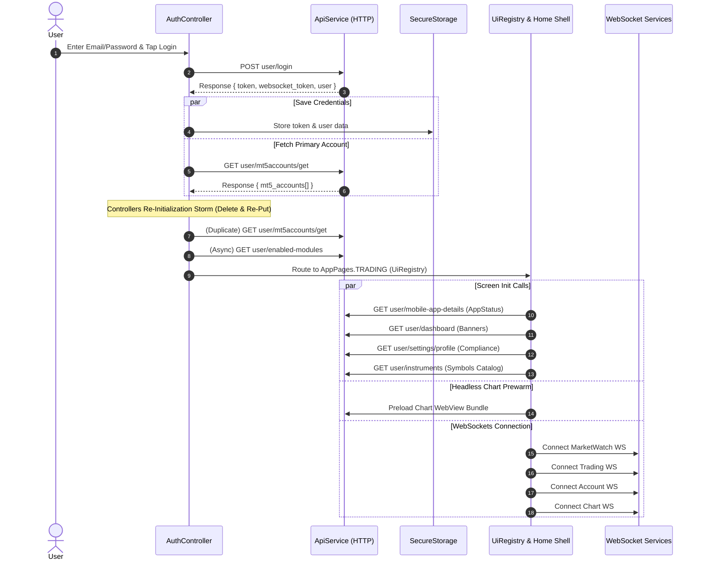

# White-Label Trading App — Complete API Flow, Flavor Architecture & Performance Optimization Guide

> **Document Type:** Architecture & Performance Audit Report  
> **Applicable Flavors / Brands:** Vantage (and children: Pipze, Telifox, Kantara, GtxPrime, Riyadex, Tenax), iQuote (and children: Baazex, Skyriss), Meta, Celestial  
> **Target Framework:** Flutter (GetX Architecture)  
> **Date:** August 2026

---

## 📑 Table of Contents
1. [Executive Summary](#1-executive-summary)
2. [Complete App API Directory (Endpoint Mapping)](#2-complete-app-api-directory-endpoint-mapping)
3. [Login to Home Screen Flow & API Lifecycle](#3-login-to-home-screen-flow--api-lifecycle)
4. [Flavor-Wise Architecture & Screen Breakdown](#4-flavor-wise-architecture--screen-breakdown)
   - [4.1 Vantage Family](#41-vantage-family)
   - [4.2 iQuote Family](#42-iquote-family)
   - [4.3 Meta Flavor](#43-meta-flavor)
   - [4.4 Celestial Flavor](#44-celestial-flavor)
5. [Performance Bottlenecks Identified](#5-performance-bottlenecks-identified)
6. [Actionable Speed & Performance Optimization Plan](#6-actionable-speed--performance-optimization-plan)
7. [Recommended Code Improvements & Best Practices](#7-recommended-code-improvements--best-practices)

---

## 1. Executive Summary

Yeh document app ke pure backend integration, screen routing, flavor mechanics, aur network life-cycle ka detailed analysis provide karta hai. Iska primary objective app ke **boot time**, **login transition time**, **memory footprint**, aur **real-time WebSocket processing** ko optimize karke app ko 2x se 3x fast banana hai.

---

## 2. Complete App API Directory (Endpoint Mapping)

Neeche app ke sabhi features aur modules me use hone wali APIs ki complete list di gayi hai:

### 🔐 Authentication & Session Management
| Endpoint | Method | Triggering File / Controller | Description |
| :--- | :--- | :--- | :--- |
| `user/login` | `POST` | `auth_controller.dart` / `auth_repository_impl.dart` | User authentication via email & password |
| `user/register` | `POST` | `auth_controller.dart` | New account registration |
| `user/send-otp` | `POST` | `auth_controller.dart` | OTP generation for verification |
| `user/verify-otp` | `POST` | `auth_controller.dart` | Verification of sent OTP |
| `user/password/forgot` | `POST` | `auth_controller.dart` | Request password reset OTP |
| `user/password/verify-otp` | `POST` | `auth_controller.dart` | Verify password reset OTP |
| `user/password/reset` | `POST` | `auth_controller.dart` | Set new password after OTP verification |
| `user/auth/google/verify-login-otp` | `POST` | `google_otp_service.dart` | 2FA Google Authenticator validation |
| `user/logout` | `POST` | `auth_controller.dart` | Session termination & server token revoking |
| `user/settings/delete-account` | `POST` | `auth_controller.dart` | Account deletion request |

### ⚙️ System, Config & Feature Flags
| Endpoint | Method | Triggering File / Controller | Description |
| :--- | :--- | :--- | :--- |
| `user/mobile-app-details` | `GET` | `app_status_service.dart` | Version control & maintenance mode verification |
| `user/crm-settings` | `GET` | `crm_settings_service.dart` | CRM dynamic configuration & styling |
| `user/enabled-modules` | `GET` | `enabled_modules_service.dart` | Per-user feature flags (CopyTrading, Bonus, IB, etc.) |
| `user/register-fcm-token` | `POST` | `notification_service.dart` | Register device push notification token |

### 📈 MT5 & Trading Accounts Management
| Endpoint | Method | Triggering File / Controller | Description |
| :--- | :--- | :--- | :--- |
| `user/mt5accounts/get` | `GET` | `dashboard_controller.dart`, `websocket_endpoint_helper.dart` | Fetch list of MT5 Real & Demo accounts |
| `user/mt5accounts/plandetails` | `GET` | `dashboard_controller.dart` | Account opening groups & leverage packages |
| `user/mt5accounts/create` | `POST` | `create_crm_app_account_screen.dart` | Open new Real or Demo MT5 account |
| `user/mt5accounts/changeleverage` | `POST` | `change_leverage_screen.dart` | Update MT5 account leverage |
| `user/mt5accounts/changepassword` | `POST` | `change_password_screen.dart` | Change MT5 master/investor trading password |
| `user/mt5accounts/resetinvestorpassword` | `POST` | `account_management_screen.dart` | Reset read-only investor password |
| `user/mt5accounts/changePrimaryAccount` | `POST` | `dashboard_controller.dart` | Switch default active trading account |
| `user/mt5accounts/setbalance` | `POST` | `dashboard_controller.dart` | Top-up virtual balance for Demo accounts |
| `user/mt5accounts/mt5AccountSync` | `POST` | `dashboard_controller.dart` | Trigger manual synchronization of MT5 data |

### 📊 Market Watch, Instruments & Ticks
| Endpoint | Method | Triggering File / Controller | Description |
| :--- | :--- | :--- | :--- |
| `user/instruments` | `GET` | `instruments_controller.dart`, `search_instruments_controller.dart` | Full catalogue of tradable symbols and groups |
| `user/instruments/{accountNumber}` | `GET` | `instruments_controller.dart` | Symbols specific to a plan/group |
| `user/trade/getSymbolDetails` / `symbols` | `GET` | `symbol_details_cache_service.dart` | Lot size, spread precision, contract sizes |

### ⚡ Trade Execution & Position Management
| Endpoint | Method | Triggering File / Controller | Description |
| :--- | :--- | :--- | :--- |
| `user/trade/new-order` | `POST` | `trading_controller.dart` | Place Market (Buy/Sell) or Pending order |
| `user/trade/closePositionByPositionId` | `POST` | `trading_controller.dart`, `close_position_screen.dart` | Close single open position |
| `user/trade/closePositions` | `POST` | `trading_controller.dart` | Bulk close positions (all, buy only, sell only) |
| `user/trade/modify-pending-order` | `POST` | `trading_controller.dart`, `edit_order_screen.dart` | Update price/volume for pending order |
| `user/trade/closePendingOrder` / `cancel` | `POST` | `trading_controller.dart` | Cancel/delete pending order |
| `user/trade/update-tp-sl` | `POST` | `trading_controller.dart` | Update Take Profit / Stop Loss on position |
| `user/trade/update-pending-order-tp-sl` | `POST` | `trading_controller.dart` | Update TP/SL on pending order |
| `user/trade/tradehistory` | `GET` | `trading_controller.dart`, History screens | Paginated closed orders & trade history |

### 💰 Finance, Wallet, Deposit & Withdrawal
| Endpoint | Method | Triggering File / Controller | Description |
| :--- | :--- | :--- | :--- |
| `user/wallet` | `GET` | `wallet_repository_impl.dart` | Main wallet balance and currency overview |
| `user/deposit` | `GET` | `finance_repository_impl.dart` | Available payment gateways & instructions |
| `user/deposit/depositrequest` | `POST Multipart` | `finance_repository_impl.dart` | Manual bank transfer / payment proof upload |
| `user/deposit/cregis` | `POST` | `finance_repository_impl.dart` | Generate Cregis Crypto invoice |
| `user/deposit/by-reference` | `GET` | `finance_repository_impl.dart` | Poll payment status by transaction reference |
| `user/transactions` | `GET` | `transaction_history_controller.dart` | Ledger of deposits, withdrawals, transfers |
| `user/withdrawal` | `GET` | `finance_repository_impl.dart` | Withdrawal methods and currency limits |
| `user/withdrawal/getUserWithdrawalMethods` | `GET` | `finance_repository_impl.dart` | User's saved bank accounts / crypto addresses |
| `user/withdrawal/sendOTP` | `POST` | `finance_repository_impl.dart` | Send OTP before withdrawal submission |
| `user/withdrawal/withdrawalrequest` | `POST` | `finance_repository_impl.dart` | Submit withdrawal request |
| `user/withdrawal/checkbalance` | `GET` | `finance_repository_impl.dart` | Real-time balance check before withdrawal |
| `user/internaltransfer` | `GET` | `finance_repository_impl.dart` | MT5 to Wallet / Wallet to MT5 transfer info |
| `user/internaltransfer/request` | `POST` | `finance_repository_impl.dart` | Execute internal transfer |
| `user/internaltransfer/history` | `GET` | `finance_repository_impl.dart` | Internal transfer history ledger |
| `user/utility/currency-list` | `GET` | `finance_repository_impl.dart` | Supported currencies list |

### 👤 Profile, KYC & Compliance
| Endpoint | Method | Triggering File / Controller | Description |
| :--- | :--- | :--- | :--- |
| `user/settings/profile` | `GET` / `POST` | `profile_repository_impl.dart` | View or update personal profile details |
| `user/settings/change-password` | `POST` | `change_password_screen.dart` | Update CRM login password |
| `user/settings/google-otp/generate` | `POST` | `google_otp_service.dart` | Generate 2FA QR & secret key |
| `user/settings/google-otp/verify` | `POST` | `google_otp_service.dart` | Verify and activate 2FA |
| `user/settings/google-otp/disable` | `POST` | `google_otp_service.dart` | Deactivate 2FA |
| `user/kyc` | `GET` | `kyc_repository_impl.dart` | Current KYC submission & approval status |
| `user/kyc/submit-unified` | `POST Multipart` | `kyc_repository_impl.dart` | ID Proof, Address Proof & Selfie upload |
| `user/regulation` | `GET` / `POST` | `compliance_controller.dart` | Regulatory questionnaire & compliance checks |
| `user/settings/getCountryDropdown` | `GET` | `dropdown_service.dart` | Countries list |
| `user/settings/getStateDropdown` | `POST` | `dropdown_service.dart` | States list by country |
| `user/settings/getCityDropdown` | `POST` | `dropdown_service.dart` | Cities list by state |

### 🤝 Introducing Broker (IB / IBM)
| Endpoint | Method | Triggering File / Controller | Description |
| :--- | :--- | :--- | :--- |
| `ibm/client/system` | `GET` | `ibm_api_provider.dart` | Client IB gate: `is_partner`, `can_apply` status |
| `ibm/client/partner-request` | `POST` / `GET` | `ibm_api_provider.dart` | Apply to become an IB / Check request status |
| `ibm/client/account-groups` | `GET` | `ibm_api_provider.dart` | Client assignment account groups |
| `ibm/portal/dashboard` | `GET` | `ibm_api_provider.dart` | Partner earnings, volume & top clients |
| `ibm/portal/dashboard/activity` | `GET` | `ibm_api_provider.dart` | Downline activity feed |
| `ibm/portal/network` | `GET` | `ibm_api_provider.dart` | Sub-IB network tree |
| `ibm/portal/clients` | `GET` | `ibm_api_provider.dart` | Referred clients list & commissions |
| `ibm/portal/wallet` | `GET` | `ibm_api_provider.dart` | Partner commission wallet & payouts |
| `ibm/portal/wallet/withdraw` | `POST` | `ibm_api_provider.dart` | Request partner commission withdrawal |
| `ibm/portal/links` | `GET` / `POST` | `ibm_api_provider.dart` | Referral links management & statistics |

### 👥 Copy Trading
| Endpoint | Method | Triggering File / Controller | Description |
| :--- | :--- | :--- | :--- |
| `copytrading/masters` | `GET` | `copy_trading_main_screen.dart` | Public list of Master Traders & performance |
| `user/copytrading/master/status` | `GET` | `copy_trading_controller.dart` | User's Master account status |
| `user/copytrading/master/dashboard-overview` | `GET` | `copy_trading_controller.dart` | Master trader metrics, copiers & profit |
| `user/copytrading/copier/subscriptions` | `GET` | `copy_trading_controller.dart` | Active copy subscriptions list |
| `user/copytrading/copier/subscribe` | `POST` | `copy_trading_controller.dart` | Start copying a Master trader |
| `user/copytrading/copier/eligible-accounts` | `GET` | `copy_trading_controller.dart` | Available MT5 accounts for copying |

### 🏆 Demo Contest & Bonus
| Endpoint | Method | Triggering File / Controller | Description |
| :--- | :--- | :--- | :--- |
| `user/demo-contest/contests` | `GET` | `demo_contest_service.dart` | Active & upcoming trading competitions |
| `user/demo-contest/my-stats` | `GET` | `demo_contest_service.dart` | User's rank, PnL, equity in contest |
| `user/demo-contest/{id}/enroll-preview` | `GET` | `demo_contest_service.dart` | Contest rules, account specs before joining |
| `user/demo-contest/{id}/enroll` | `POST` | `demo_contest_service.dart` | Register & open contest trading account |
| `user/demo-contest/{id}/leaderboard` | `GET` | `demo_contest_service.dart` | Live contest leaderboard rankings |
| `user/bonus` | `GET` | `bonus_repository_impl.dart` | Available deposit/trading bonus schemes |
| `user/bonus/bonusClaim` | `POST` | `bonus_repository_impl.dart` | Claim bonus on qualifying account |

---

## 3. Login to Home Screen Flow & API Lifecycle



---

## 4. Flavor-Wise Architecture & Screen Breakdown

White-label codebase `BrandResolver` aur `UiRegistry` design pattern use karti hai:

### 4.1 Vantage Family
*Brands: Vantage, Pipze, Telifox, Kantara, GtxPrime, Riyadex, Tenax*
- **Main Shell Widget:** `TradingMainScreen` (5-tab floating action dock layout)
- **Tab Layout:**
  - **Tab 0 (Prices):** `InstrumentsScreen` — Catalogue fetch karta hai (`GET user/instruments`) aur MarketWatch socket connect karta hai.
  - **Tab 1 (Chart):** `ChartScreen` / `VantageChartLayout` — Prewarmed chart webview & dynamic timeframe/tool overlays render karta hai.
  - **Tab 2 (Markets/Trade):** `TradeScreen` — Real-time open positions, pending orders, closed trades display karta hai.
  - **Tab 3 (Accounts):** `DashboardScreen` — MT5 accounts cards, balance, leverage, deposit shortcuts dikhata hai (`GET user/mt5accounts/get`).
  - **Tab 4 (Settings/More):** `MoreScreen` — Profile, KYC, IB, Finance, Settings links.

### 4.2 iQuote Family
*Brands: iQuote, Baazex, Skyriss*
- **Main Shell Widget:** `TradingMainScreen` (`FlavorConfig.usesIquoteUi() == true`)
- **Tab Layout:**
  - **Tab 0 (Home):** `IquoteHomeScreen` — Banners slider (`GET user/dashboard`), quick stats, top gainers/losers, real-time sparklines (60 points history).
  - **Tab 1 (Markets):** `IquoteMarketScreen` — Group-wise categorized instruments list with live bid/ask quotes.
  - **Tab 2 (Charts):** `IQuoteChartScreen` — Fullscreen interactive charts.
  - **Tab 3 (Position):** `IQuotePositionScreen` — Live floating PnL, margin level, quick close buttons.
  - **Tab 4 (Assets):** `MoreScreen` — Financial overview & user settings.

### 4.3 Meta Flavor
*Brand: Meta*
- **Main Shell Widget:** `MetaMainShell` (MT5 standard UI design)
- **Tab Layout:**
  - **Tab 0 (Quotes):** `MetaWatchlistScreen` — Simple/Advanced quote list mode (Spread, High, Low, Bid, Ask).
  - **Tab 1 (Charts):** `MetaChartScreen` — Meta-styled trading charts.
  - **Tab 2 (Trade):** `MetaTradeScreen` — Balance bar (Balance, Equity, Margin, Free Margin) + Open trades list.
  - **Tab 3 (History):** `MetaHistoryScreen` — Date-wise filtered trades (`GET user/trade/tradehistory`).
  - **Tab 4 (Settings):** `MetaSettingsScreen` — Account details, mailbox, news, theme settings.

### 4.4 Celestial Flavor
*Brand: Celestial*
- **Main Shell Widget:** `CelestialMainShell` (Dark/Gold luxury aesthetic)
- **Tab Layout:**
  - **Tab 0 (Watchlist):** `CelestialWatchlistScreen` — Categorized symbols watchlist.
  - **Tab 1 (Charts):** `CelestialChartScreen` — In-line quick order placement from chart.
  - **Tab 2 (Trade):** `CelestialTradeScreen` — Net PnL hero card + active orders.
  - **Tab 3 (History):** `CelestialHistoryScreen` — Trade history log.
  - **Tab 4 (Settings):** `CelestialSettingsScreen` — User profile, security, app preferences.

---

## 5. Performance Bottlenecks Identified

Audit ke dauran 6 major areas identify huye hain jo app ko slow karte hain:

1. **🔴 Redundant Duplicate API Calls on Startup:**
   - Login ke waqt `mt5accounts/get` API **3 baar** trigger hoti hai (Login flow me, naye `DashboardController.onInit()` me, aur Home screen mount hone par).

2. **🔴 Garbage Collection Spikes (Delete-and-Recreate Storm):**
   - Login complete hote hi `AuthController` 7 controllers ko delete karke dobara recreate karta hai:
     `DashboardController`, `AccountController`, `InstrumentsController`, `ChartSocketController`, `TradingController`, `TradingWebSocketService`, `AccountWebSocketService`.
   - Isse memory deallocation aur reallocation ki wajah se **200ms - 400ms ka frame freeze** hota hai.

3. **🔴 Eager `IndexedStack` Rendering (Sari Tabs Ek Saath Mount Hoti Hain):**
   - `IndexedStack` saari 5 tabs ko ek hi time par widget tree me render kar deta hai. Isse phone ke CPU/GPU par ek sath 5 screens ka rendering load padta hai jabki user ko sirf pehli tab dekhni hoti hai.

4. **🔴 WebSocket Connection Choke:**
   - 4 alag-alag WebSocket connections ek hi frame me open hote hain (MarketWatch, Trading, Account, Chart). Slow networks par packet handshake congestion create hota hai.

5. **🔴 Blocking HTTP Calls on Main Thread:**
   - Banners, App-status, aur Compliance profile calls ek ke baad ek wait karti hain bajaye background parallel execution ke.

6. **🔴 High-Frequency Quote Tick Rebuilds:**
   - High market volatility ke waqt agar 50+ symbols ke ticks per second aate hain, to improper batching UI FPS drop ka reason banti hai.

---

## 6. Actionable Speed & Performance Optimization Plan

App ko ultra-fast banane ke liye yeh 6-step roadmap follow karein:

```
[Phase 1: Zero-Duplicate Network]
  └── AccountCacheService me 10s TTL lagayein. Duplicate `mt5accounts/get` band karein.

[Phase 2: Controller In-Place Reset]
  └── Delete/Put loop hatayein -> `resetSession(newToken)` method call karein.

[Phase 3: Lazy-Loaded Tabs]
  └── IndexedStack ke upar LazyTabWrapper lagayein (sirf active tab build hogi).

[Phase 4: Parallel Startup Pipeline]
  └── Banners + Status + Profile ko `Future.wait()` me background load karein.

[Phase 5: Staggered WebSocket Connections]
  └── Priority 1: MarketWatch & Account WS. Priority 2: Chart WS (on demand).

[Phase 6: 60 FPS Micro-Batching]
  └── Symbols quotes ko 100ms throttle buffer me batch karein.
```

---

## 7. Recommended Code Improvements & Best Practices

### A. Lazy Tab Wrapper Example (Zero Overhead Tab Switching)
```dart
class LazyTabWrapper extends StatefulWidget {
  final int index;
  final int currentIndex;
  final Widget child;

  const LazyTabWrapper({
    super.key,
    required this.index,
    required this.currentIndex,
    required this.child,
  });

  @override
  State<LazyTabWrapper> createState() => _LazyTabWrapperState();
}

class _LazyTabWrapperState extends State<LazyTabWrapper> {
  bool _hasBeenLoaded = false;

  @override
  Widget build(BuildContext context) {
    if (widget.index == widget.currentIndex) {
      _hasBeenLoaded = true;
    }

    if (!_hasBeenLoaded) {
      return const SizedBox.shrink(); // Mount nothing until first viewed
    }

    return widget.child;
  }
}
```

### B. In-Place Controller Session Reset (GC Elimination)
```dart
// Instead of Get.delete<DashboardController>() + Get.put(DashboardController())
void resetForNewUser(String newToken, MT5Account? primaryAccount) {
  _currentWebSocketEndpoint = null;
  _accountInfoMap.clear();
  if (primaryAccount != null) {
    mt5Accounts.assignAll([primaryAccount]);
    hasMT5Accounts.value = true;
  }
  _bindUnifiedAccountStream();
}
```

---

### 📌 Summary
Yeh file kisi bhi developer ya team member ke sath share ki ja sakti hai. Isme app ka end-to-end network architecture, screen routing, aur performance improvement steps clearly documented hain.
