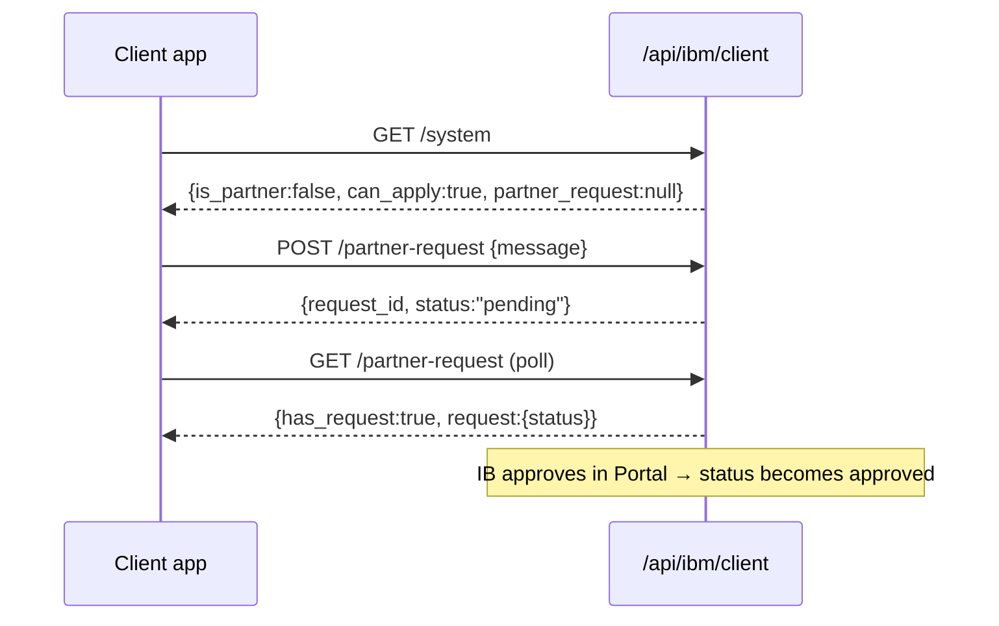
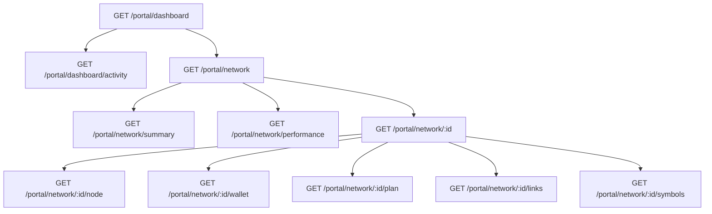
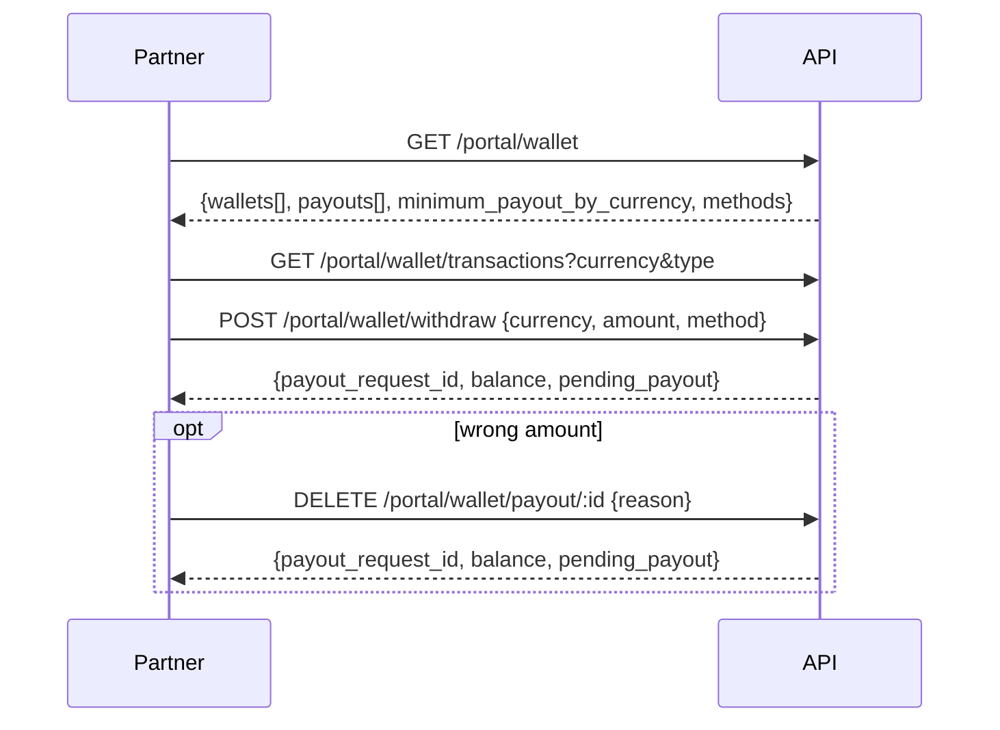

# IB Manager — Client-Side API (Flow-Wise)

**Scope:** client-facing endpoints only (Partner **Portal** + ordinary **Client**). Admin `admin.ibm.*` routes are excluded.
**Source of truth:** `core/Modules/IBManager/Routes/api.php`.
**Import for Postman:** `POSTMAN_CLIENT_API.postman_collection.json` (same folder).

---

## 1. Conventions

### Auth
- All authenticated calls use **Sanctum bearer token**: `Authorization: Bearer <token>`, `Accept: application/json`.
- **Portal** group `/api/ibm/portal/*` → middleware `['auth:sanctum', 'ibm.auth']`. `ibm.auth` requires an active, unsuspended profile **and** a hierarchy row — a referred client with only a profile is rejected.
- **Client** group `/api/ibm/client/*` → middleware `['auth:sanctum']` only. Ordinary clients, NOT partners.
- **Public** `/api/ibm/r/{code}` and `/r/{code}` → no auth, throttled 60/min.

### Response envelope (Portal + most Client)
```jsonc
// success
{ "success": true,  "message": "", "data": <payload> }      // HTTP 200
// failure
{ "success": false, "message": "…", "data": null | {violations:[…]} }  // 400/403/404/422
```
- **Ownership failures answer 404** (not 403) — probing an id you don't own can't confirm it exists.
- **Validation failures answer 422**; cap/limit failures carry `data.violations`.
- **Exceptions:** `marketing/{id}/download` returns a **file stream** on success (JSON only on error). `SystemController@show` 401 omits the `data` key.

### Common query params
- `period`: `today | 7d | 30d | mtd | this_month | all | custom`. With `custom` add `from` + `to` (dates).
- `scope` (dashboard/clients): `direct | network | total`.
- Pagination: request `page` + `per_page` (cap 100); response `pagination: {page, per_page, total, last_page}`.
- All timestamps are `Y-m-d H:i:s` strings or `null`.

---

## 2. Flow A — Ordinary client becomes a partner (IB)



1. **`GET /api/ibm/client/system`** — the one gate the client app calls before drawing any IB screen. Tells you `is_partner`, `can_apply`, and any open `partner_request` (status always shown as `pending`).
2. **`POST /api/ibm/client/partner-request`** `{ message? }` — target IB is taken from the client's live assignment, not the body. `422` already-a-partner, `409` duplicate pending.
3. **`GET /api/ibm/client/partner-request`** — poll status (`pending`/`approved`/`rejected` + `rejection_reason`).

## 3. Flow B — Referred client opens a trading account

1. Public link click: **`GET /api/ibm/r/{code}`** (or `/r/{code}`) — records the visit, sets `ibm_visitor` + `ibm_ref` cookies. JSON when `Accept: application/json`, else redirect to registration.
2. After login: **`GET /api/ibm/client/referral`** — reads `ibm_ref` cookie → `{has_referral, code, label}` to show "referred by".
3. Opening an account: **`GET /api/ibm/client/account-groups`** → `{groups:[{plan_group_id,name,is_default}], auto_select, source}`. `auto_select` true only when exactly one group. Generic names only; MT5 group path stays backend-side.

## 4. Flow C — Partner dashboard & drill-down (read)



- **`GET /portal/dashboard`** `?period&scope` — overview cards: per-currency deposits/withdrawals/equity/commission, `clients`, `partners`, `funnel`, `top_earners`.
- **`GET /portal/dashboard/activity`** — recent deposits / withdrawals / payouts / accounts / requests across the downline.
- **`GET /portal/network`** `?period&page&per_page&parent_id` — paginated sub-IB rows.
- **`GET /portal/network/summary`** — `direct` / `network` / `total` scope blocks side-by-side.
- **`GET /portal/network/tree-summary`** — `{direct, total, clients}` counts for the top of the tree.
- **`GET /portal/network/performance`** `?sort&dir` — ranked, searched, totalled server-side (scales to thousands).
- **`GET /portal/network/{partnerUserId}`** + sub-resources `/node`, `/wallet`, `/plan`, `/links`, `/symbols` — one partner drill-down. `/plan` shows rates only when you wrote the plan. Not-yours id → 404.

## 5. Flow D — Partner's own clients

- **`GET /portal/clients`** `?period&scope&under_ib&link_id&q&page&per_page` — client list with `summary`, filter options (`partners`, `links`), and per-client `currencies`.
- **`GET /portal/clients/network-tree`** — grouped by the partner who owns each client (recursive `nodes`/`children`).
- **`GET /portal/clients/{clientUserId}`** — full client profile: `upline`, assignment `history`, money `events`, `symbols`, `totals`, `accounts`.
- **`GET /portal/clients/{clientUserId}/accounts`** — accounts with balance/equity/trades/commission.
- **`GET /portal/clients/{clientUserId}/accounts/{accountId}/trades`** — trade feed for one account (`account` populated).
- **`GET /portal/clients/{clientUserId}/trades`** — every account at once (`account: null`). Same shape, paginated, with `totals`.

## 6. Flow E — Sub-IB request approval (partner acting as approver)

1. **`GET /portal/requests`** `?status=pending|approved|rejected|cancelled|all` — inbound sub-IB applications.
2. **`POST /portal/requests/{requestId}/approve`** `{ plan_id, plan_group_ids[] }` — **two success shapes**:
   - Manual mode → `{ awaiting_admin: true }` (goes to broker for final approval).
   - Automatic mode → `{ plan_id, plan_group_ids }` (live immediately).
   - `422` already-decided, or over-cap with `data.violations`.
3. **`POST /portal/requests/{requestId}/reject`** `{ reason? }`.

## 7. Flow F — Partner plans (sub-IB commission templates)

1. **`GET /portal/partner-plans`** — list.
2. **`GET /portal/partner-plans/template`** — blank draft + caps + symbol catalogue for the builder.
3. **`GET /portal/partner-plans/{planId}`** — an existing plan's draft + caps.
4. **`POST /portal/partner-plans`** `{ name, description?, groups:[{group_id, rates{catId:rate}, symbol_rates{symId:rate}, blocked_symbol_ids[]}] }` → `{ plan_id, caps }`. Over-cap → `422 {caps, violations}`.
5. **`PUT /portal/partner-plans/{planId}`** — same body, `{ plan_id, caps }`.
6. **`DELETE /portal/partner-plans/{planId}`** — `422` when active sub-IB assignments exist.
7. **`GET /portal/partner-plans/sub-ibs`** — assignable sub-IBs.
8. **`POST /portal/partner-plans/{planId}/assign`** `{ partner_user_id }` — `403` not-your-sub-IB, `422` over-cap `{violations}` / already-on-plan.

## 8. Flow G — Client visibility (which groups a partner can offer)

- **`GET /portal/client-visibility`** — groups with `is_visible` / `is_default`, plus `default_plan_group_id`, `visible_count`.
- **`POST /portal/client-visibility`** `{ plan_group_ids[], default_plan_group_id? }` — `422` empty list / not-on-plan `{violations}` / default outside visible.

## 9. Flow H — Referral links (partner's own)

- **`GET /portal/links`** — links with `counts:{visits,unique_visits,signups,accounts,funded}`.
- **`POST /portal/links`** `{ label, code?, plan_group_ids[], default_plan_group_id?, expires_at? }` → `{link_id, code}`. `code` auto-generated if omitted; `422` taken code / bad default.
- **`PUT /portal/links/{linkId}`** `{ label?, is_active?, plan_group_ids?, default_plan_group_id?, expires_at? }`.
- **`DELETE /portal/links/{linkId}`** — `422` for a generic/default link.
- **`GET /portal/links/{linkId}/stats`** `?period` — `counts`, `earned[]` by currency, `daily[]`.
- **`GET /portal/links/{linkId}/clients`** `?period` — who this link brought in.

## 10. Flow I — Wallet & payout (partner earnings out)



- **`GET /portal/wallet`** — per-currency `wallets` (balance, pending, lifetime, `can_withdraw`, `minimum_payout`), recent `payouts`, `methods`, `minimum_payout_by_currency`.
- **`GET /portal/wallet/transactions`** `?currency&type&page&per_page` — ledger; `type` ∈ `commission|correction|payout|payout_reversal|adjustment|clawback`. Commission rows carry a nested `trade`.
- **`POST /portal/wallet/withdraw`** `{ currency, amount, method_slug?, withdrawal_method_id? }` → `{payout_request_id, currency, amount, balance, pending_payout}`. `422` invalid method / rejected.
- **`DELETE /portal/wallet/payout/{payoutId}`** `{ reason? }` — withdraw your own request (one open payout per wallet). `404` not found; `422` broker-raised/non-cancellable.

## 11. Flow J — Marketing material (partner promotes)

- **`GET /portal/marketing`** `?category&q` — published `materials` + non-empty `categories`.
- **`GET /portal/marketing/{materialId}/download`** — **file stream** on success; `404` JSON if not available / file missing.

---

## 12. Client-side endpoint index

### Client — `/api/ibm/client` (auth:sanctum)
| Method | Path | Purpose |
|---|---|---|
| GET | `/system` | IB-screen gate: is_partner / can_apply / open request |
| GET | `/account-groups` | Groups offered when a referred client opens an account |
| POST | `/partner-request` | Apply to become a partner |
| GET | `/partner-request` | Own application status |
| GET | `/referral` | Current referral from `ibm_ref` cookie |

### Public referral (no auth, throttled)
| Method | Path | Purpose |
|---|---|---|
| GET | `/r/{code}` | Web landing — record click, set cookies, redirect |
| GET | `/api/ibm/r/{code}` | Same handler under API prefix; JSON when `Accept: application/json` |

### Portal — `/api/ibm/portal` (auth:sanctum + ibm.auth)
| Method | Path | Purpose |
|---|---|---|
| GET | `/dashboard` | Overview cards |
| GET | `/dashboard/activity` | Downline activity feed |
| GET | `/network` | Sub-IB rows (paginated) |
| GET | `/network/summary` | direct/network/total blocks |
| GET | `/network/tree-summary` | Top-of-tree counts |
| GET | `/network/performance` | Ranked partners |
| GET | `/network/{id}` | Partner detail |
| GET | `/network/{id}/node` | Partner's clients + sub-IBs |
| GET | `/network/{id}/wallet` | Downline wallet |
| GET | `/network/{id}/plan` | Downline plan (rates if yours) |
| GET | `/network/{id}/links` | Downline links |
| GET | `/network/{id}/symbols` | Symbols the branch paid on |
| GET | `/clients` | Own clients list |
| GET | `/clients/network-tree` | Clients grouped by owning partner |
| GET | `/clients/{id}` | Client detail |
| GET | `/clients/{id}/accounts` | Client accounts |
| GET | `/clients/{id}/accounts/{accId}/trades` | Trades — one account |
| GET | `/clients/{id}/trades` | Trades — all accounts |
| GET | `/plan` | Own plan (full rates) |
| GET | `/plan/groups` | Own plan groups |
| GET | `/partner-plans` | Partner plan templates list |
| GET | `/partner-plans/template` | Blank draft for builder |
| GET | `/partner-plans/sub-ibs` | Assignable sub-IBs |
| GET | `/partner-plans/{id}` | Plan detail |
| POST | `/partner-plans` | Create plan |
| PUT | `/partner-plans/{id}` | Update plan |
| DELETE | `/partner-plans/{id}` | Delete plan |
| POST | `/partner-plans/{id}/assign` | Assign plan to a sub-IB |
| GET | `/client-visibility` | Group visibility |
| POST | `/client-visibility` | Save visibility |
| GET | `/links` | Own referral links |
| POST | `/links` | Create link |
| PUT | `/links/{id}` | Update link |
| DELETE | `/links/{id}` | Delete link |
| GET | `/links/{id}/stats` | Link stats |
| GET | `/links/{id}/clients` | Clients via link |
| GET | `/requests` | Inbound sub-IB requests |
| POST | `/requests/{id}/approve` | Approve request |
| POST | `/requests/{id}/reject` | Reject request |
| GET | `/wallet` | Wallet overview |
| GET | `/wallet/transactions` | Wallet ledger |
| POST | `/wallet/withdraw` | Request payout |
| DELETE | `/wallet/payout/{id}` | Cancel own payout |
| GET | `/marketing` | Marketing materials |
| GET | `/marketing/{id}/download` | Download material (file stream) |
