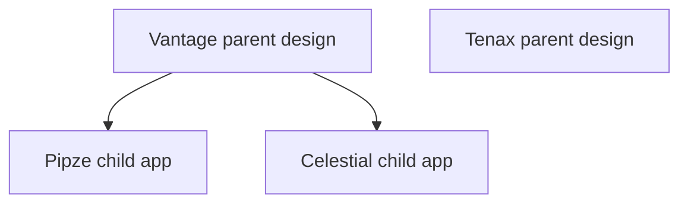
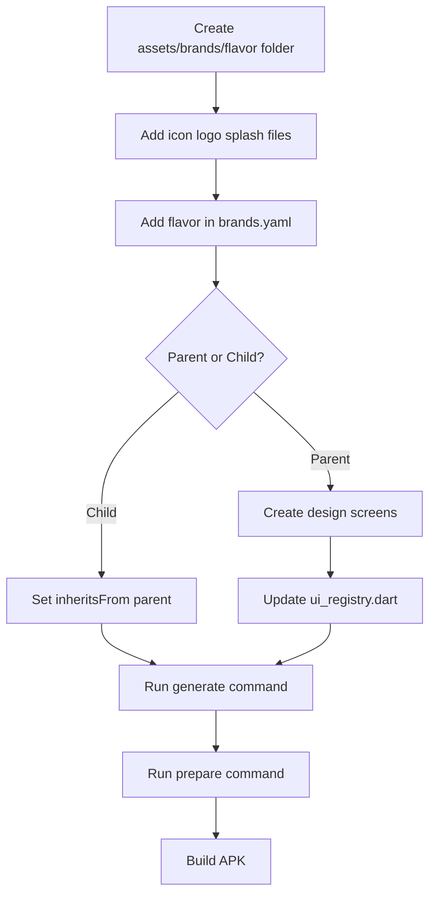
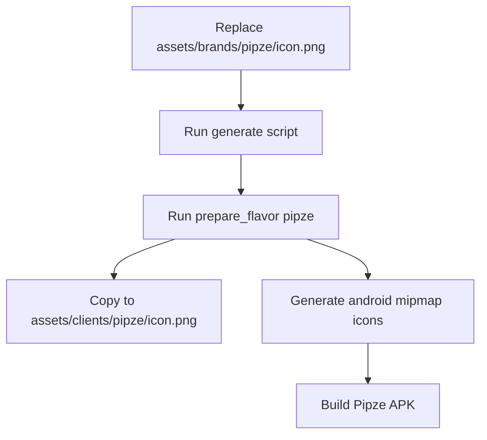
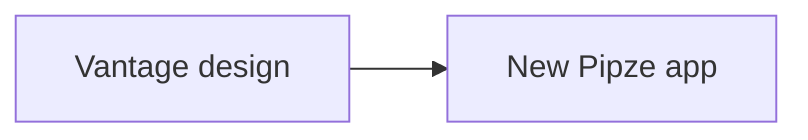
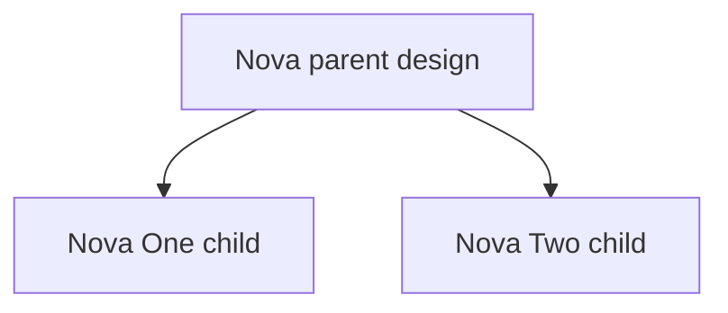
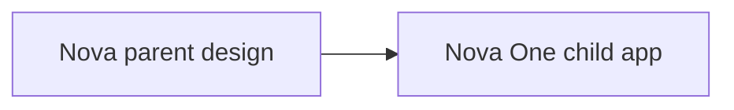
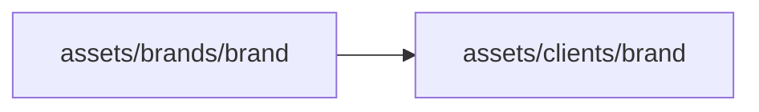
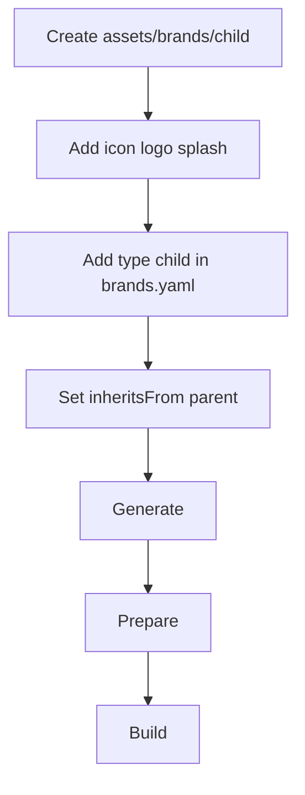
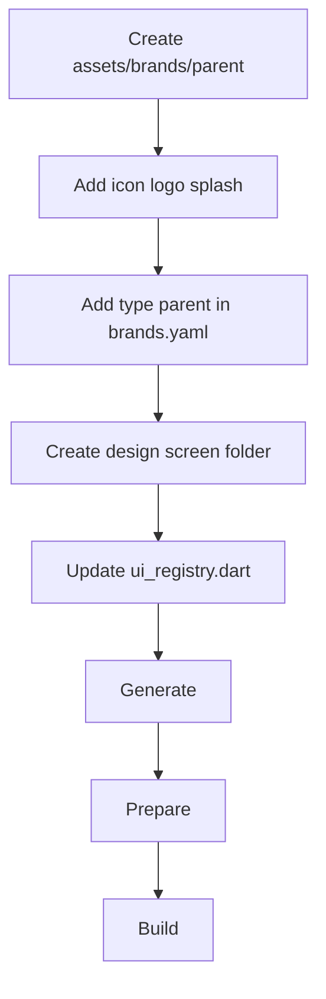

# White Label Flutter App — Easy Flavor Guide

This README explains **how to add a new app flavor/client** in simple steps.

In this project, a flavor means one branded app, for example:

- `vantage`
- `pipze`
- `celestial`
- `tenax`

## Simple meaning of parent and child

A brand can be either **parent** or **child**.

- **Parent brand** = has its own app design/screens.
- **Child brand** = uses parent brand design/screens, but has its own logo, app icon, colors, app name, and API URLs.

Current example:



Meaning:

- `vantage` has its own design.
- `pipze` uses `vantage` design.
- `celestial` uses `vantage` design.
- `tenax` is another parent.

---

# Very important folders

## 1. Main brand config file

All flavors are added here:

```shell
/Users/admin/Desktop/Project/white_label/app/white_label/assets/config/brands/brands.yaml
```

This file controls:

- flavor name
- parent or child
- app name
- Android package name
- iOS bundle id
- colors
- API URLs
- logo/icon/splash paths

## 2. Brand image folder

Every flavor must have its own image folder here:

```shell
/Users/admin/Desktop/Project/white_label/app/white_label/assets/brands/<flavor_name>/
```

Example for `pipze`:

```shell
/Users/admin/Desktop/Project/white_label/app/white_label/assets/brands/pipze/
```

Inside every flavor folder, these 3 files are required:

```shell
/Users/admin/Desktop/Project/white_label/app/white_label/assets/brands/pipze/icon.png
/Users/admin/Desktop/Project/white_label/app/white_label/assets/brands/pipze/logo.svg
/Users/admin/Desktop/Project/white_label/app/white_label/assets/brands/pipze/splash_logo.svg
```

## 3. Parent design screen folder

If you create a **new parent design**, screens go here:

```shell
/Users/admin/Desktop/Project/white_label/app/white_label/lib/screens/auth/presentation/brands/<parent_name>/pages/
```

Example for `vantage` parent:

```shell
/Users/admin/Desktop/Project/white_label/app/white_label/lib/screens/auth/presentation/brands/vantage/pages/
```

If you make new parent `nova`, then create:

```shell
/Users/admin/Desktop/Project/white_label/app/white_label/lib/screens/auth/presentation/brands/nova/pages/
```

## 4. UI registry file

This file tells app which design parent to use:

```shell
/Users/admin/Desktop/Project/white_label/app/white_label/lib/app/ui_registry.dart
```

Example:

- `pipze` uses `vantage`
- `celestial` uses `vantage`
- `novaone` uses `nova`

---

# Complete flavor creation flow



---

# How Pipze icon is set now

Pipze app icon is already set from this file:

```shell
/Users/admin/Desktop/Project/white_label/app/white_label/assets/brands/pipze/icon.png
```

The Pipze config in `brands.yaml` points to that icon:

```yaml
/Users/admin/Desktop/Project/white_label/app/white_label/assets/config/brands/brands.yaml
  - name: pipze
    type: child
    inheritsFrom: vantage
    label: Pipze
    assets:
      appIcon: assets/brands/pipze/icon.png
      logo: assets/brands/pipze/logo.svg
      splashLogo: assets/brands/pipze/splash_logo.svg
```

The generated launcher icon file also uses the same icon:

```yaml
/Users/admin/Desktop/Project/white_label/app/white_label/lib/clients/pipze/launcher_icons.yaml
flutter_launcher_icons:
  image_path: "assets/brands/pipze/icon.png"
  adaptive_icon_foreground: "assets/brands/pipze/icon.png"
```

Do not edit `lib/clients/pipze/launcher_icons.yaml` manually because it is generated.

## Change Pipze app icon

Use these steps when you want to replace Pipze launcher icon.

### Step 1 — Replace icon file

Replace this file with your new icon:

```shell
/Users/admin/Desktop/Project/white_label/app/white_label/assets/brands/pipze/icon.png
```

Recommended icon size:

- PNG
- square image
- `512 x 512` or `1024 x 1024`
- file name must stay `icon.png`

### Step 2 — Regenerate config

```shell
/Users/admin/Desktop/Project/white_label/app/white_label
cd /Users/admin/Desktop/Project/white_label/app/white_label
dart run scripts/generate_brand_config.dart
```

### Step 3 — Prepare Pipze flavor

```shell
/Users/admin/Desktop/Project/white_label/app/white_label
dart run scripts/prepare_flavor.dart pipze
```

This copies:

```shell
/Users/admin/Desktop/Project/white_label/app/white_label/assets/brands/pipze/icon.png
```

to:

```shell
/Users/admin/Desktop/Project/white_label/app/white_label/assets/clients/pipze/icon.png
```

It also generates Android launcher icons inside:

```shell
/Users/admin/Desktop/Project/white_label/app/white_label/android/app/src/pipze/res/mipmap-*/
```

### Step 4 — Build Pipze APK

Debug:

```shell
/Users/admin/Desktop/Project/white_label/app/white_label
flutter build apk --flavor pipze --dart-define=CLIENT=pipze --dart-define=FLAVOR=pipze --debug
```

Release:

```shell
/Users/admin/Desktop/Project/white_label/app/white_label
./build.sh pipze apk release
```

## Pipze icon flow chart



---

# Case 1: Add new child flavor under existing parent

Use this when your new app should use the same design as an existing parent.

Example:

- New flavor name: `newpipze`
- Parent design: `vantage`

So `newpipze` will use Vantage screens, but it will have its own app icon/logo/colors/API.

## Step 1 — Go to project folder

```shell
/Users/admin/Desktop/Project/white_label/app/white_label
cd /Users/admin/Desktop/Project/white_label/app/white_label
```

## Step 2 — Create image folder

```shell
/Users/admin/Desktop/Project/white_label/app/white_label
mkdir -p assets/brands/newpipze
```

## Step 3 — Add these 3 image files

Put your files here:

```shell
/Users/admin/Desktop/Project/white_label/app/white_label/assets/brands/newpipze/icon.png
/Users/admin/Desktop/Project/white_label/app/white_label/assets/brands/newpipze/logo.svg
/Users/admin/Desktop/Project/white_label/app/white_label/assets/brands/newpipze/splash_logo.svg
```

Check folder:

```shell
/Users/admin/Desktop/Project/white_label/app/white_label
ls assets/brands/newpipze
```

You should see:

```shell
/Users/admin/Desktop/Project/white_label/app/white_label
icon.png
logo.svg
splash_logo.svg
```

## Step 4 — Open brands.yaml

Open this file:

```shell
/Users/admin/Desktop/Project/white_label/app/white_label/assets/config/brands/brands.yaml
```

Add this under `brands:`:

```yaml
/Users/admin/Desktop/Project/white_label/app/white_label/assets/config/brands/brands.yaml
  - name: newpipze
    type: child
    inheritsFrom: vantage
    label: New Pipze
    android:
      applicationId: com.newpipze.app
      appName: New Pipze
    ios:
      bundleId: com.newpipze.app
      appName: New Pipze
    colors:
      primary: "#5F259E"
      secondary: "#F8F3FF"
      accent: "#FFC93C"
    urls:
      api: https://my.newpipze.com/api/
      websocket: wss://my.newpipze.com/trade-engine
      chart: https://my.newpipze.com
    assets:
      appIcon: assets/brands/newpipze/icon.png
      logo: assets/brands/newpipze/logo.svg
      splashLogo: assets/brands/newpipze/splash_logo.svg
```

Important lines:

```yaml
/Users/admin/Desktop/Project/white_label/app/white_label/assets/config/brands/brands.yaml
type: child
inheritsFrom: vantage
```

This means:



## Step 5 — Generate files

```shell
/Users/admin/Desktop/Project/white_label/app/white_label
dart run scripts/generate_brand_config.dart
```

This creates/updates generated files like:

```shell
/Users/admin/Desktop/Project/white_label/app/white_label/lib/clients/newpipze/config.dart
/Users/admin/Desktop/Project/white_label/app/white_label/lib/clients/newpipze/launcher_icons.yaml
/Users/admin/Desktop/Project/white_label/app/white_label/assets/config/brands/brands.json
/Users/admin/Desktop/Project/white_label/app/white_label/android/brand_flavors.gradle
```

## Step 6 — Prepare flavor assets

```shell
/Users/admin/Desktop/Project/white_label/app/white_label
dart run scripts/prepare_flavor.dart newpipze
```

This copies files from:

```shell
/Users/admin/Desktop/Project/white_label/app/white_label/assets/brands/newpipze/
```

to:

```shell
/Users/admin/Desktop/Project/white_label/app/white_label/assets/clients/newpipze/
```

## Step 7 — Build debug APK

```shell
/Users/admin/Desktop/Project/white_label/app/white_label
flutter build apk --flavor newpipze --dart-define=CLIENT=newpipze --dart-define=FLAVOR=newpipze --debug
```

## Step 8 — Build release APK

```shell
/Users/admin/Desktop/Project/white_label/app/white_label
./build.sh newpipze apk release
```

---

# Case 2: Add new parent flavor with new design

Use this when the new app has a different design.

Example:

- New parent flavor name: `nova`
- `nova` has its own screens/design.



## Step 1 — Go to project folder

```shell
/Users/admin/Desktop/Project/white_label/app/white_label
cd /Users/admin/Desktop/Project/white_label/app/white_label
```

## Step 2 — Create image folder

```shell
/Users/admin/Desktop/Project/white_label/app/white_label
mkdir -p assets/brands/nova
```

## Step 3 — Add these 3 files

```shell
/Users/admin/Desktop/Project/white_label/app/white_label/assets/brands/nova/icon.png
/Users/admin/Desktop/Project/white_label/app/white_label/assets/brands/nova/logo.svg
/Users/admin/Desktop/Project/white_label/app/white_label/assets/brands/nova/splash_logo.svg
```

## Step 4 — Add parent brand in brands.yaml

Open:

```shell
/Users/admin/Desktop/Project/white_label/app/white_label/assets/config/brands/brands.yaml
```

Add:

```yaml
/Users/admin/Desktop/Project/white_label/app/white_label/assets/config/brands/brands.yaml
  - name: nova
    type: parent
    label: Nova
    android:
      applicationId: com.nova.app
      appName: Nova
    ios:
      bundleId: com.nova.app
      appName: Nova
    colors:
      primary: "#123456"
      secondary: "#FFFFFF"
      accent: "#FFAA00"
    urls:
      api: https://my.nova.com/api/
      websocket: wss://my.nova.com/trade-engine
      chart: https://my.nova.com
    assets:
      appIcon: assets/brands/nova/icon.png
      logo: assets/brands/nova/logo.svg
      splashLogo: assets/brands/nova/splash_logo.svg
```

Important line:

```yaml
/Users/admin/Desktop/Project/white_label/app/white_label/assets/config/brands/brands.yaml
type: parent
```

## Step 5 — Create parent design folder

```shell
/Users/admin/Desktop/Project/white_label/app/white_label
mkdir -p lib/screens/auth/presentation/brands/nova/pages
```

## Step 6 — Copy Vantage design as starting point

This is easiest way to start new parent design:

```shell
/Users/admin/Desktop/Project/white_label/app/white_label
cp lib/screens/auth/presentation/brands/vantage/pages/*.dart lib/screens/auth/presentation/brands/nova/pages/
```

Now edit files inside:

```shell
/Users/admin/Desktop/Project/white_label/app/white_label/lib/screens/auth/presentation/brands/nova/pages/
```

Example files:

```shell
/Users/admin/Desktop/Project/white_label/app/white_label/lib/screens/auth/presentation/brands/nova/pages/get_started_screen.dart
/Users/admin/Desktop/Project/white_label/app/white_label/lib/screens/auth/presentation/brands/nova/pages/login_screen.dart
/Users/admin/Desktop/Project/white_label/app/white_label/lib/screens/auth/presentation/brands/nova/pages/create_account_screen.dart
/Users/admin/Desktop/Project/white_label/app/white_label/lib/screens/auth/presentation/brands/nova/pages/forgot_password_screen.dart
/Users/admin/Desktop/Project/white_label/app/white_label/lib/screens/auth/presentation/brands/nova/pages/verify_code_screen.dart
/Users/admin/Desktop/Project/white_label/app/white_label/lib/screens/auth/presentation/brands/nova/pages/create_new_password_screen.dart
```

Important: after copy, rename widget class names from Vantage to Nova if needed.

Example:

- `VantageLoginScreen` → `NovaLoginScreen`
- `VantageCreateAccountScreen` → `NovaCreateAccountScreen`

## Step 7 — Register Nova design in UiRegistry

Open:

```shell
/Users/admin/Desktop/Project/white_label/app/white_label/lib/app/ui_registry.dart
```

Add imports for Nova pages:

```dart
/Users/admin/Desktop/Project/white_label/app/white_label/lib/app/ui_registry.dart
import '../screens/auth/presentation/brands/nova/pages/create_account_screen.dart';
import '../screens/auth/presentation/brands/nova/pages/create_new_password_screen.dart';
import '../screens/auth/presentation/brands/nova/pages/forgot_password_screen.dart';
import '../screens/auth/presentation/brands/nova/pages/get_started_screen.dart';
import '../screens/auth/presentation/brands/nova/pages/login_screen.dart';
import '../screens/auth/presentation/brands/nova/pages/verify_code_screen.dart';
```

Find this map:

```dart
/Users/admin/Desktop/Project/white_label/app/white_label/lib/app/ui_registry.dart
static const Map<String, String> _uiParentByClient = {
  'vantage': 'vantage',
  'celestial': 'vantage',
  'pipze': 'vantage',
  'tenax': 'tenax',
};
```

Add `nova`:

```dart
/Users/admin/Desktop/Project/white_label/app/white_label/lib/app/ui_registry.dart
static const Map<String, String> _uiParentByClient = {
  'vantage': 'vantage',
  'celestial': 'vantage',
  'pipze': 'vantage',
  'tenax': 'tenax',
  'nova': 'nova',
};
```

Then update widget methods.

Example login method:

```dart
/Users/admin/Desktop/Project/white_label/app/white_label/lib/app/ui_registry.dart
@override
Widget login() {
  if (_uiBrand == 'nova') return const NovaLoginScreen();
  if (_usesVantageUi) return const VantageLoginScreen();
  return const LoginScreen();
}
```

Do same for these methods:

- `getStarted()`
- `login()`
- `createAccount()`
- `forgotPassword()`
- `verifyCode()`
- `createNewPassword()`

## Step 8 — Generate files

```shell
/Users/admin/Desktop/Project/white_label/app/white_label
dart run scripts/generate_brand_config.dart
```

## Step 9 — Prepare Nova

```shell
/Users/admin/Desktop/Project/white_label/app/white_label
dart run scripts/prepare_flavor.dart nova
```

## Step 10 — Build Nova debug

```shell
/Users/admin/Desktop/Project/white_label/app/white_label
flutter build apk --flavor nova --dart-define=CLIENT=nova --dart-define=FLAVOR=nova --debug
```

## Step 11 — Build Nova release

```shell
/Users/admin/Desktop/Project/white_label/app/white_label
./build.sh nova apk release
```

---

# Case 3: Add child flavor under your new parent

Example:

- Parent: `nova`
- Child: `novaone`

Meaning:

- `novaone` uses `nova` design.
- `novaone` has its own logo/icon/colors/API.



## Step 1 — Create child image folder

```shell
/Users/admin/Desktop/Project/white_label/app/white_label
mkdir -p assets/brands/novaone
```

## Step 2 — Add 3 image files

```shell
/Users/admin/Desktop/Project/white_label/app/white_label/assets/brands/novaone/icon.png
/Users/admin/Desktop/Project/white_label/app/white_label/assets/brands/novaone/logo.svg
/Users/admin/Desktop/Project/white_label/app/white_label/assets/brands/novaone/splash_logo.svg
```

## Step 3 — Add child in brands.yaml

Open:

```shell
/Users/admin/Desktop/Project/white_label/app/white_label/assets/config/brands/brands.yaml
```

Add:

```yaml
/Users/admin/Desktop/Project/white_label/app/white_label/assets/config/brands/brands.yaml
  - name: novaone
    type: child
    inheritsFrom: nova
    label: Nova One
    android:
      applicationId: com.novaone.app
      appName: Nova One
    ios:
      bundleId: com.novaone.app
      appName: Nova One
    colors:
      primary: "#123456"
      secondary: "#FFFFFF"
      accent: "#FFAA00"
    urls:
      api: https://my.novaone.com/api/
      websocket: wss://my.novaone.com/trade-engine
      chart: https://my.novaone.com
    assets:
      appIcon: assets/brands/novaone/icon.png
      logo: assets/brands/novaone/logo.svg
      splashLogo: assets/brands/novaone/splash_logo.svg
```

Important lines:

```yaml
/Users/admin/Desktop/Project/white_label/app/white_label/assets/config/brands/brands.yaml
type: child
inheritsFrom: nova
```

## Step 4 — Register child in UiRegistry

Open:

```shell
/Users/admin/Desktop/Project/white_label/app/white_label/lib/app/ui_registry.dart
```

Add `novaone` to map:

```dart
/Users/admin/Desktop/Project/white_label/app/white_label/lib/app/ui_registry.dart
static const Map<String, String> _uiParentByClient = {
  'vantage': 'vantage',
  'celestial': 'vantage',
  'pipze': 'vantage',
  'tenax': 'tenax',
  'nova': 'nova',
  'novaone': 'nova',
};
```

Now `novaone` uses Nova UI.

## Step 5 — Generate files

```shell
/Users/admin/Desktop/Project/white_label/app/white_label
dart run scripts/generate_brand_config.dart
```

## Step 6 — Prepare child

```shell
/Users/admin/Desktop/Project/white_label/app/white_label
dart run scripts/prepare_flavor.dart novaone
```

## Step 7 — Build child debug

```shell
/Users/admin/Desktop/Project/white_label/app/white_label
flutter build apk --flavor novaone --dart-define=CLIENT=novaone --dart-define=FLAVOR=novaone --debug
```

## Step 8 — Build child release

```shell
/Users/admin/Desktop/Project/white_label/app/white_label
./build.sh novaone apk release
```

---

# What each command does

## Generate command

```shell
/Users/admin/Desktop/Project/white_label/app/white_label
dart run scripts/generate_brand_config.dart
```

This reads:

```shell
/Users/admin/Desktop/Project/white_label/app/white_label/assets/config/brands/brands.yaml
```

And creates/updates:

```shell
/Users/admin/Desktop/Project/white_label/app/white_label/assets/config/brands/brands.json
/Users/admin/Desktop/Project/white_label/app/white_label/lib/flavor_config.dart
/Users/admin/Desktop/Project/white_label/app/white_label/lib/clients/<brand>/config.dart
/Users/admin/Desktop/Project/white_label/app/white_label/lib/clients/<brand>/launcher_icons.yaml
/Users/admin/Desktop/Project/white_label/app/white_label/android/brand_flavors.gradle
/Users/admin/Desktop/Project/white_label/app/white_label/.vscode/launch.json
```

## Prepare command

```shell
/Users/admin/Desktop/Project/white_label/app/white_label
dart run scripts/prepare_flavor.dart <brand>
```

This copies brand assets:



It also updates app icon and native splash resources.

## Build command

Debug:

```shell
/Users/admin/Desktop/Project/white_label/app/white_label
flutter build apk --flavor <brand> --dart-define=CLIENT=<brand> --dart-define=FLAVOR=<brand> --debug
```

Release:

```shell
/Users/admin/Desktop/Project/white_label/app/white_label
./build.sh <brand> apk release
```

Universal release APK:

```shell
/Users/admin/Desktop/Project/white_label/app/white_label
./build.sh <brand> apk release universal
```

App bundle:

```shell
/Users/admin/Desktop/Project/white_label/app/white_label
./build.sh <brand> appbundle release
```

Build all brands:

```shell
/Users/admin/Desktop/Project/white_label/app/white_label
./build.sh all apk release
```

---

# Easy checklist

## For child flavor



Checklist:

- [ ] Create folder `assets/brands/<child>/`
- [ ] Add `icon.png`
- [ ] Add `logo.svg`
- [ ] Add `splash_logo.svg`
- [ ] Add brand entry in `brands.yaml`
- [ ] Set `type: child`
- [ ] Set `inheritsFrom: <parent>`
- [ ] If parent is new, add mapping in `ui_registry.dart`
- [ ] Run `dart run scripts/generate_brand_config.dart`
- [ ] Run `dart run scripts/prepare_flavor.dart <child>`
- [ ] Build APK

## For parent flavor



Checklist:

- [ ] Create folder `assets/brands/<parent>/`
- [ ] Add `icon.png`
- [ ] Add `logo.svg`
- [ ] Add `splash_logo.svg`
- [ ] Add brand entry in `brands.yaml`
- [ ] Set `type: parent`
- [ ] Create design folder `lib/screens/auth/presentation/brands/<parent>/pages/`
- [ ] Add/copy/edit design screens
- [ ] Update imports in `lib/app/ui_registry.dart`
- [ ] Update `_uiParentByClient` in `lib/app/ui_registry.dart`
- [ ] Route parent widgets in `UiRegistry` methods
- [ ] Run `dart run scripts/generate_brand_config.dart`
- [ ] Run `dart run scripts/prepare_flavor.dart <parent>`
- [ ] Build APK

---

# Existing example to copy

## Parent: Vantage

Config:

```shell
/Users/admin/Desktop/Project/white_label/app/white_label/assets/config/brands/brands.yaml
```

Assets:

```shell
/Users/admin/Desktop/Project/white_label/app/white_label/assets/brands/vantage/
```

Design screens:

```shell
/Users/admin/Desktop/Project/white_label/app/white_label/lib/screens/auth/presentation/brands/vantage/pages/
```

## Child: Pipze

Config:

```shell
/Users/admin/Desktop/Project/white_label/app/white_label/assets/config/brands/brands.yaml
```

Assets:

```shell
/Users/admin/Desktop/Project/white_label/app/white_label/assets/brands/pipze/
```

Uses design from:

```shell
/Users/admin/Desktop/Project/white_label/app/white_label/lib/screens/auth/presentation/brands/vantage/pages/
```

Because Pipze has:

```yaml
/Users/admin/Desktop/Project/white_label/app/white_label/assets/config/brands/brands.yaml
type: child
inheritsFrom: vantage
```

---

# Common problems

## Problem: Unknown flavor

Run:

```shell
/Users/admin/Desktop/Project/white_label/app/white_label
dart run scripts/generate_brand_config.dart
```

Then check:

```shell
/Users/admin/Desktop/Project/white_label/app/white_label/assets/config/brands/brands.json
```

## Problem: Logo not showing

Check source files:

```shell
/Users/admin/Desktop/Project/white_label/app/white_label
ls assets/brands/<brand>
```

Run prepare again:

```shell
/Users/admin/Desktop/Project/white_label/app/white_label
dart run scripts/prepare_flavor.dart <brand>
```

Check prepared files:

```shell
/Users/admin/Desktop/Project/white_label/app/white_label
ls assets/clients/<brand>
```

## Problem: App icon not changed

Run:

```shell
/Users/admin/Desktop/Project/white_label/app/white_label
dart run scripts/prepare_flavor.dart <brand>
```

Then rebuild app.

## Problem: New parent design not showing

Check this file:

```shell
/Users/admin/Desktop/Project/white_label/app/white_label/lib/app/ui_registry.dart
```

Make sure:

- parent is added in `_uiParentByClient`
- parent screen imports are added
- widget methods return parent screens

