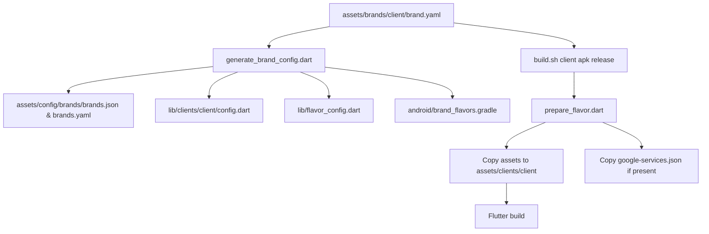

# Brand Flavor Workflow

This project now supports a **simplified one client = one folder** layout.
All configurations, icons, and logo assets for a client live inside their specific directory.

Each brand keeps editable artwork and configs in:

`assets/brands/<brand>/`

Required files inside the folder:

- `brand.yaml` — local single brand manifest (contains app configs, colors, and URLs)
- `icon.png` — app/launcher icon source
- `logo.svg` — in-app logo
- `splash_logo.svg` — splash logo
- `google-services.json` — optional Firebase config

Runtime/build-prepared artwork is copied to:

`assets/clients/<brand>/`

Do not edit `assets/clients/<brand>/` by hand. It is prepared by `scripts/prepare_flavor.dart`.

## Add a new brand

1. Create the source asset folder:

```shell
/Users/admin/Desktop/Project/white_label/app/white_label
mkdir -p assets/brands/mybrand
```

2. Add the required artwork to `assets/brands/mybrand/`:
   - `icon.png`
   - `logo.svg`
   - `splash_logo.svg`

3. Create the `brand.yaml` inside `assets/brands/mybrand/brand.yaml`:

```yaml
name: mybrand
type: child
inheritsFrom: vantage
label: My Brand
themeMode: both

android:
  applicationId: com.mybrand.app
  appName: My Brand

ios:
  bundleId: com.mybrand.app
  appName: My Brand

colors:
  primary: "#5F259E"
  secondary: "#F8F3FF"
  accent: "#FFC93C"
  splashColor: "#5F259E"
  launcherBackground: "#5F259E"

urls:
  api: https://example.com/api/
  websocket: wss://example.com/trade-engine
  chart: https://example.com

assets:
  appIcon: icon.png
  logo: logo.svg
  splashLogo: splash_logo.svg
```

4. Regenerate config files (updates launch configurations, client directory setups, and unified legacy maps):

```shell
/Users/admin/Desktop/Project/white_label/app/white_label
dart run scripts/generate_brand_config.dart
```

5. Prepare and build:

```shell
/Users/admin/Desktop/Project/white_label/app/white_label
./build.sh mybrand apk release
```

## Parent-child UI concept

- `type: parent` means the brand owns its own screen designs in `lib/screens/*/brands/{brand}/`.
- `type: child` means the brand inherits and uses another brand's screens (defined in `inheritsFrom`), while keeping its own unique colors, logos, title, and assets.



## Generated files

These files are auto-generated from `assets/brands/*/brand.yaml` and should not be edited manually:

- `assets/config/brands/brands.yaml`
- `assets/config/brands/brands.json`
- `lib/flavor_config.dart`
- `lib/clients/<brand>/config.dart`
- `lib/clients/<brand>/launcher_icons.yaml`
- `android/brand_flavors.gradle`
- `.vscode/launch.json`

## Important notes

- `pubspec.yaml` contains a script-managed active client asset block. It is updated by `scripts/prepare_flavor.dart`.
- `assets/brands/<brand>/` is the single source of truth for edit.
- `assets/clients/<brand>/` is the runtime input generated at build time.
- All temporary modular configurations (`app_config.json`) have been removed since optional features status is retrieved dynamically via the `/api/user/enabled-modules` API and unified dynamically inside `FlavorConfig` structure.
