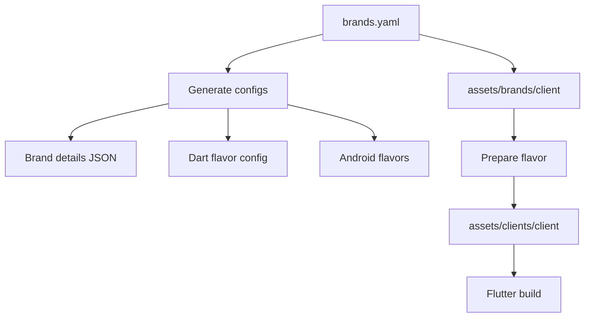

# Brand Flavor Workflow

This project uses one editable manifest for white-label brands:

`assets/config/brands/brands.yaml`

Each brand keeps editable artwork in:

`assets/brands/<brand>/`

Required artwork files by convention:

- `icon.png` — app/launcher icon source
- `logo.svg` — in-app logo
- `splash_logo.svg` — splash logo

Runtime/build-prepared artwork is copied to:

`assets/clients/<brand>/`

Do not edit `assets/clients/<brand>/` by hand. It is prepared by `scripts/prepare_flavor.dart`.

## Add a new brand

1. Create the source asset folder:

```shell
/Users/admin/Desktop/Project/white_label/app/white_label
mkdir -p assets/brands/mybrand
```

2. Add the required artwork:

```shell
/Users/admin/Desktop/Project/white_label/app/white_label
assets/brands/mybrand/icon.png
assets/brands/mybrand/logo.svg
assets/brands/mybrand/splash_logo.svg
```

3. Add the brand entry in `assets/config/brands/brands.yaml`:

```yaml
/Users/admin/Desktop/Project/white_label/app/white_label/assets/config/brands/brands.yaml
- name: mybrand
  type: child
  inheritsFrom: vantage
  label: My Brand
  android:
    applicationId: com.mybrand.app
    appName: My Brand
  ios:
    bundleId: com.mybrand.app
    appName: My Brand
  colors:
    primary: "#5F259E"
    secondary: "#F8F3FF"
    accent: "#FFC93C"
  urls:
    api: https://example.com/api/
    websocket: wss://example.com/trade-engine
    chart: https://example.com
  assets:
    appIcon: assets/brands/mybrand/icon.png
    logo: assets/brands/mybrand/logo.svg
    splashLogo: assets/brands/mybrand/splash_logo.svg
```

4. Regenerate config files:

```shell
/Users/admin/Desktop/Project/white_label/app/white_label
dart run scripts/generate_brand_config.dart
```

5. Prepare and build:

```shell
/Users/admin/Desktop/Project/white_label/app/white_label
./build.sh mybrand apk release
```

## Parent-child UI concept

- `type: parent` means the brand owns its own screen design.
- `type: child` means the brand uses another brand’s screens from `inheritsFrom`, while keeping its own colors, app name, URLs, and assets.



## Generated files

These files are generated from `brands.yaml` and should not be edited manually:

- `assets/config/brands/brands.json`
- `lib/flavor_config.dart`
- `lib/clients/<brand>/config.dart`
- `lib/clients/<brand>/launcher_icons.yaml`
- `android/brand_flavors.gradle`
- `.vscode/launch.json`

## Important notes

- `pubspec.yaml` contains a script-managed active client asset block. It is updated by `scripts/prepare_flavor.dart`.
- `assets/brands/<brand>/` is the editable source.
- `assets/clients/<brand>/` is build output/prepared runtime asset input.
- When changing brand assets or URLs, update `brands.yaml`, regenerate, then prepare/build the flavor.
