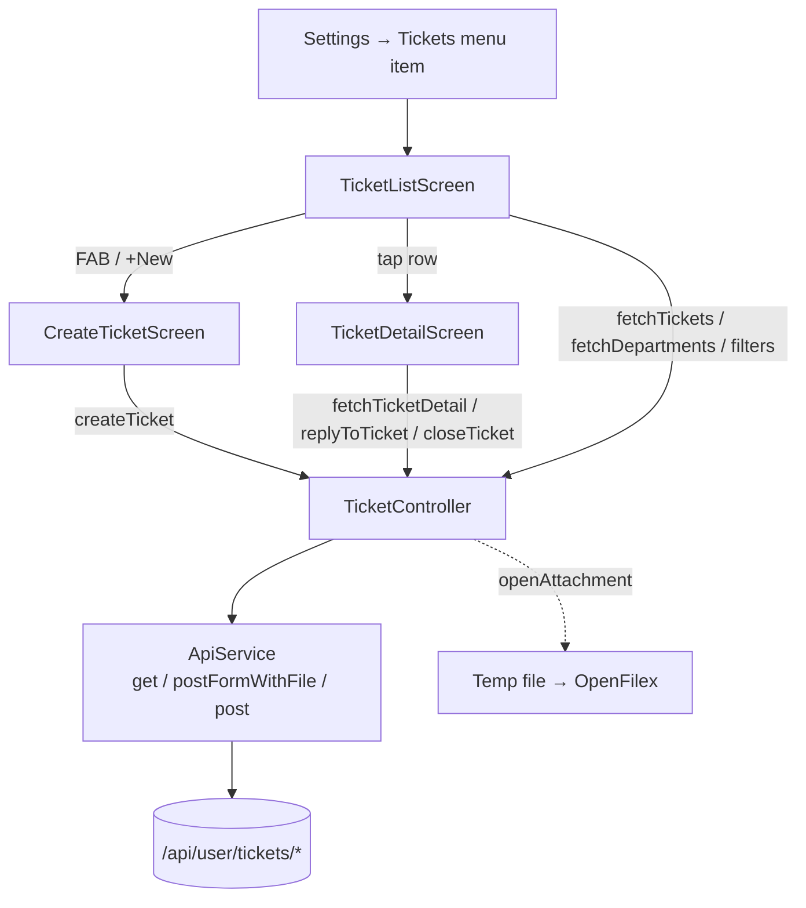
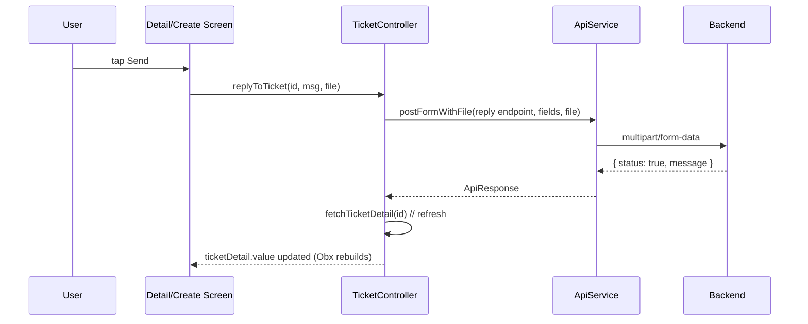
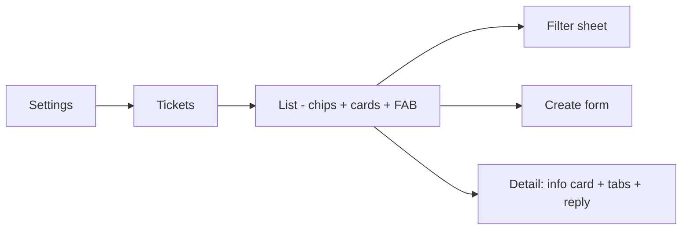

# Support Ticket Module — Implementation Plan & Documentation

This document is the single source of truth for the **Support Ticket** module
inside the White Label / CRM apps. It is written so that the same module can be
cloned into any other project (any brand flavor) with minimal effort.

It also tracks the open issues currently observed against the live web design
(reply not visible, image upload silently failing on create, broken "close
ticket" SQL, etc.) so we know exactly what needs to be fixed and where.

---

## 1. Goals

- Add a **Tickets** entry inside the **Settings** screen (mobile), matching
  the existing web design but in a **mobile-friendly, compact** layout.
- Provide a full CRUD experience: list (with filters + pagination), create,
  view detail, reply, view/download attachments, close ticket.
- Make all of the above brand-agnostic so it ships with every white-label
  brand without per-brand forks.
- Re-use existing services (`ApiService`, `LanguageService`,
  `CustomToastService`, `SecureStorageService`) — no new transport layer.

---

## 2. API Reference

All endpoints are scoped under `ajax = /api/user/` (already configured via
`ApiConstants`). Base URL is brand-specific — example for Tenax demo:
`https://demo.tenaxcode.com`.

| Purpose | Method | Endpoint | Notes |
|---|---|---|---|
| List departments | GET | `/api/user/tickets/departments` | Returns `[{id, name, icon}]` |
| List tickets | GET | `/api/user/tickets?page=&per_page=&status=&department=&priority=&search=` | Paginated. `all` is the wildcard for status / department / priority. |
| Create ticket | POST | `/api/user/tickets` | `multipart/form-data` with `department_id`, `priority`, `title`, `description`, `file` (the file field name is **`file`**, not `attachment`). |
| Ticket detail | GET | `/api/user/tickets/{id}` | Returns ticket + `conversation[]` + `attachment` |
| Reply | POST | `/api/user/tickets/{id}/reply` | **JSON** body `{ "reply_text": "..." }` (NOT multipart, no file support). |
| Close | POST | `/api/user/tickets/{id}/close` | No body |
| Download attachment | GET | `/api/user/tickets/attachment?path=...` | Auth-required; must send `Authorization: Bearer <token>` |

Already wired in `lib/constants/api_const.dart`:

```dart
static const String ticketDepartments = '${ajax}tickets/departments';
static const String tickets            = '${ajax}tickets';
static String ticketDetail(String id)  => '${ajax}tickets/$id';
static String ticketReply(String id)   => '${ajax}tickets/$id/reply';
static String ticketClose(String id)   => '${ajax}tickets/$id/close';
static const String ticketAttachment   = '${ajax}tickets/attachment';
```

### 2.1 Sample responses

**Departments**

```json
{ "status": true, "success": true, "data": [
  { "id": 1, "name": "Sales",   "icon": "/assets/sales-icon.svg" },
  { "id": 2, "name": "Account", "icon": "/assets/settings-icon.svg" },
  { "id": 3, "name": "Support", "icon": "/assets/support-icon.svg" }
]}
```

**Tickets list (paginated)**

```json
{ "status": true, "data": {
  "data": [
    { "id": "ViQVyfHW", "title": "Not working", "description": "App not working properly",
      "department": "Account", "priority": "medium", "status": "open",
      "created_at": "...", "updated_at": "...",
      "assignee": { "name": "Unassigned", "avatar": "..." },
      "conversation_count": 2 }
  ],
  "pagination": { "current_page": 1, "last_page": 1, "per_page": 6, "total": 1 }
}}
```

**Ticket detail**

```json
{ "status": true, "data": {
  "id": "ViQVyfHW", "title": "...", "description": "...",
  "department": "Account", "priority": "medium", "status": "open",
  "assignee": { "name": "Assigned", "avatar": "..." },
  "conversation": [
    { "id": 5, "type": "customer", "author": { "name": "You", "avatar": "..." },
      "content": "hi there", "timestamp": "...." }
  ],
  "attachment": {
    "filename": "503648966.jpg",
    "path": "tickets/ViQVyfHW/503648966.jpg",
    "url":  "https://.../api/user/tickets/attachment?path=tickets%2FViQVyfHW%2F503648966.jpg"
  }
}}
```

---

## 3. Project Layout (white_label)

```
lib/
├── models/
│   └── ticket_model.dart                 # TicketDepartment, Ticket, TicketDetail,
│                                         # TicketConversation, TicketAttachment,
│                                         # TicketPagination
├── bindings/
│   └── ticket_binding.dart               # GetX binding (permanent controller)
├── constants/
│   └── api_const.dart                    # ticket* endpoints
└── screens/home/more/ticket/
    ├── ticket_controller.dart            # GetX controller (state + API calls)
    ├── ticket_list_screen.dart           # List + filters + pagination
    ├── create_ticket_screen.dart         # Create form + attachment picker
    └── ticket_detail_screen.dart         # Info card + tabs (conversation / attachments) + reply
```

Routes (in `lib/routes/app_pages.dart` / `app_routes.dart`):

```dart
TICKET_LIST    = '/ticket-list'
TICKET_CREATE  = '/ticket-create'
TICKET_DETAIL  = '/ticket-detail'   // Get.toNamed(TICKET_DETAIL, arguments: ticketId)
```

All three routes use `TicketBinding` so the same `TicketController` instance
is shared (list refreshes automatically after create / reply / close).

---

## 4. Architecture



Reply / create flow (sequence):



---

## 5. Settings Integration (the new task)

Add a **Tickets** row to `lib/screens/home/more/setting/setting_screen.dart`
right under `app_preferences` (keep the same `_MenuItem` widget — no new
widgets needed):

```dart
_MenuItem(
  icon: 'ticket',                       // see asset note below
  label: languageService.tr('tickets'), // add translation key (see §7)
  onTap: () => Get.toNamed(Routes.TICKET_LIST),
  color: AppColors.textPrimary,
),
```

Asset: re-use `assets/svg/more/support/help-center.svg` (already shipped) until
a dedicated `ticket.svg` is added. The file lookup pattern is
`assets/svg/more/setting/{icon}.svg`, so either drop a new `ticket.svg`
there or change the path inline.

**Mobile-friendly compact list design** (mirrors the web, condensed for phones):

- Each row = a `Card` with: title, priority pill (low/med/high), status pill
  (open/closed), department, relative time, conversation count badge.
- Filter chips strip on top: `All / Open / Closed` + a `Filter` icon that
  opens a bottom sheet (department + priority + search).
- Pull-to-refresh + infinite scroll (pagination already supported by the
  controller via `hasMorePages` / `fetchTickets(refresh: false)`).
- FAB → `Routes.TICKET_CREATE`.



---

## 6. Known Issues (must fix before shipping)

### 6.1 Reply not appearing in ticket detail — FIXED
**Root cause**: the app was sending the reply as `multipart/form-data` with field
name `message`, but the live backend expects a **JSON** body
`{ "reply_text": "..." }`. The request would 4xx/no-op so the conversation never
grew. Fixed in `ticket_controller.dart::replyToTicket` by switching to
`ApiService.post(...)` with the correct JSON payload. The reply-bar UI no longer
has an attachment picker because the API does not accept one.

### 6.2 Image upload not working on Create — FIXED
**Root cause**: backend expects the multipart file field to be named **`file`**,
not `attachment`. The app was uploading the bytes under the wrong field, so the
server silently dropped the file. Fixed in
`ticket_controller.dart::createTicket` by setting `fileField: 'file'`.

### 6.3 Close ticket fails with SQL error
```
SQLSTATE[01000]: Warning: 1265 Data truncated for column 'action_type'
insert into `user_ticket_timelines` (... `action_type` ...) values (97, ticket closed, ...)
```
This is a **server bug**: `action_type` is an ENUM and `ticket closed` is not in the enum list (should likely be `ticket_closed`). Action: report to backend team — no app change required. We should still treat `status: false` gracefully (already done via `CustomToastService.showError`).

### 6.4 Attachment download
The endpoint `/api/user/tickets/attachment?path=...` is **token-protected**. Tapping the link must call `controller.openAttachment(attachment)` which already injects `Authorization: Bearer <token>`, writes to temp dir, and opens with `OpenFilex`. Do **not** open the raw URL in a webview — it will 401.

---

## 7. Translation Keys (add to every `assets/translations/*.json`)

```
tickets                  → "Tickets"
ticket_new_ticket        → "New Ticket"
ticket_department        → "Department"
ticket_select_department → "Select department"
ticket_priority          → "Priority"
ticket_select_priority   → "Select priority"
ticket_priority_low      → "Low"
ticket_priority_medium   → "Medium"
ticket_priority_high     → "High"
ticket_subject           → "Subject"
ticket_subject_hint      → "Brief summary"
ticket_description       → "Description"
ticket_description_hint  → "Describe your issue"
ticket_attachment        → "Attachment"
ticket_attach_files      → "Tap to attach a file"
ticket_attachment_formats→ "JPG, PNG, PDF, DOC (max 5 MB)"
ticket_create            → "Create"
ticket_cancel            → "Cancel"
ticket_detail            → "Ticket"
ticket_reference         → "Reference"
ticket_created           → "Created"
ticket_assignee          → "Assignee"
ticket_unassigned        → "Unassigned"
ticket_status_open       → "Open"
ticket_status_closed     → "Closed"
ticket_close             → "Close ticket"
ticket_close_confirm     → "Are you sure you want to close this ticket?"
ticket_tab_all           → "Conversation"
ticket_tab_attachments   → "Attachments"
ticket_no_data           → "No messages yet"
ticket_no_tickets        → "No tickets found"
```

Languages already in the project: `en, ar, es, hi, tr`.

---

## 8. Step-by-Step Cloning Recipe (for any new project)

1. **Copy 4 files** from `white_label` to the target project (preserve paths):
   - `lib/models/ticket_model.dart`
   - `lib/bindings/ticket_binding.dart`
   - `lib/screens/home/more/ticket/*` (all 4 files)
2. **Append API constants** in `lib/constants/api_const.dart` (block in §2).
3. **Register routes** in `app_routes.dart` + `app_pages.dart`
   (`TICKET_LIST / TICKET_CREATE / TICKET_DETAIL` with `TicketBinding`).
4. **Add menu item** in `setting_screen.dart` (snippet in §5).
5. **Add translation keys** in §7 to every locale JSON.
6. **Add the SVG icon** at `assets/svg/more/setting/ticket.svg` (or reuse
   `support/help-center.svg`).
7. **Verify dependencies** in `pubspec.yaml`:
   - `get`, `http`, `file_picker`, `open_filex`, `path_provider`,
     `flutter_screenutil`, `flutter_svg` — all already present in
     `white_label`/`crm_app`.
8. Run, login, navigate to **Settings → Tickets**.

---

## 9. Open Questions / Possibly Missing APIs

- **Mark conversation as read** — web shows unread counts on each row
  (`conversation_count`) but there is no `mark-as-read` endpoint exposed. Ask
  backend if `PATCH /tickets/{id}/read` exists; otherwise treat
  `conversation_count` as informational only.
- **Reopen closed ticket** — not in the documented surface. Confirm with
  backend, else hide the action when `status == closed`.
- **File-size / MIME limits** — backend limits are not documented. We enforce
  5 MB client-side; align with backend.
- **Multiple attachments per reply** — current API field is singular
  (`attachment`). Confirm if `attachment[]` is supported for batch upload.
- **Priority values** — we assume `low / medium / high`. Confirm exact enum
  expected by backend (e.g. is `urgent` valid?).

---

## 10. Checklist

- [ ] Add `Tickets` row in Settings screen
- [ ] Verify `Routes.TICKET_LIST` opens the list
- [ ] Pull-to-refresh + paginated scroll works
- [ ] Filter chips (status) + filter sheet (department/priority/search) wired
- [ ] Create ticket with **and without** attachment uploads successfully
- [ ] Reply with text only, with attachment, and refresh shows new bubble
- [ ] Attachment chip opens file via `OpenFilex` (no 401)
- [ ] Close ticket — once backend SQL bug is fixed
- [ ] All translations present in 5 locales
- [ ] No per-brand fork needed (lives in the shared `crm_app` package)
